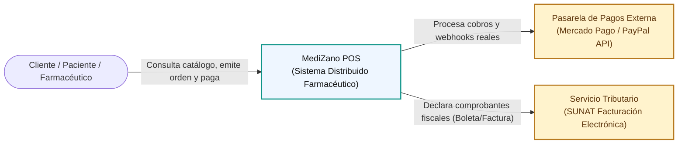
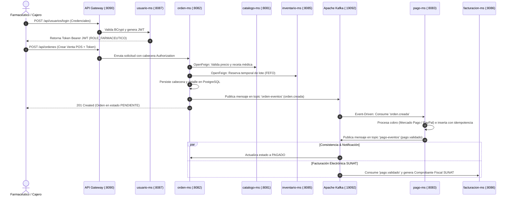

# MediZano POS - Microservicios Farmacéuticos 2026-2

Sistema empresarial distribuido de Punto de Venta (POS) y Gestión Farmacéutica — proyecto del curso **Desarrollo de Aplicaciones Distribuidas** (DIST), UPeU 2026-2.

> [!IMPORTANT]
> ### 🚀 Tablero de Enlaces Directos en Vivo (1-Click Access)
> Abre directamente cualquiera de los paneles locales haciendo clic en sus enlaces:
> 
> * 📖 **Portal de Documentación MkDocs:** [http://localhost:8000/medizano/](http://localhost:8000/medizano/)
> * 📑 **Swagger UI Centralizado (API Gateway):** [http://localhost:8090/swagger-ui.html](http://localhost:8090/swagger-ui.html)
> * 🔭 **Eureka Service Discovery:** [http://localhost:8761/](http://localhost:8761/)
> * 📨 **Kafka UI (Kafbat Message Broker):** [http://localhost:18085/](http://localhost:18085/)
> * 📊 **Grafana Observabilidad:** [http://localhost:3000/](http://localhost:3000/) *(Credenciales: `admin` / `admin`)*
> * 📈 **Prometheus Server:** [http://localhost:9090/](http://localhost:9090/)
> * 📬 **Mailpit Webmail (Simulador SMTP):** [http://localhost:8025/](http://localhost:8025/)
> * 🎯 **Guía Maestra de Sustentación:** [Abrir Guía de Exposición](docs/proyecto-sello/guia-exposicion.md)

---

## 🏛️ Repositorio Oficial y Arquitectura del Sistema

* 🐙 **Repositorio Oficial en GitHub:** [https://github.com/rbn-69-cod/MediZano_microservicios](https://github.com/rbn-69-cod/MediZano_microservicios)


---

## 1. Documentación del Curso

La documentación técnica completa (sílabo, C4, brief técnico, alcance y rúbricas oficiales) vive en [`docs/`](docs/index.md) y se publica como sitio con **MkDocs Material**:

* **Sitio Web:** [MediZano POS Docs (http://localhost:8000/medizano/)](http://localhost:8000/medizano/)
* **Guía de Exposición y Sustentación:** [`docs/proyecto-sello/guia-exposicion.md`](docs/proyecto-sello/guia-exposicion.md)
* **Brief Técnico (Hito S2):** [`docs/proyecto-sello/brief.md`](docs/proyecto-sello/brief.md)
* **Producto Unidad 1 (S5):** [`docs/proyecto-sello/u1-producto.md`](docs/proyecto-sello/u1-producto.md)
* **Producto Unidad 2 (Rúbrica Oficial S12):** [`docs/proyecto-sello/u2-producto.md`](docs/proyecto-sello/u2-producto.md)
* **Alcance por Microservicio y Base de Datos:** [`docs/proyecto-sello/alcance-microservicios.md`](docs/proyecto-sello/alcance-microservicios.md)

---

## 2. Equipo de Desarrollo (4 Integrantes)

Cumpliendo con la directiva oficial de la cátedra (**2 microservicios por persona: 1 Transaccional cabecera-detalle + 1 No Transaccional catálogo/CRUD**):

| N° | Integrante | Microservicio Transaccional (Cabecera - Detalle) | Microservicio No Transaccional (Catálogo / Maestro) | Rol y Énfasis Técnico |
| :---: | :--- | :--- | :--- | :--- |
| **1** | **Kenyi Calsin** | **`orden-ms`** (`:8082`)<br>• Tablas: `ordenes` y `orden_detalles` | **`cliente-ms`** (`:8084`)<br>• Tabla: `clientes` (DNI/RUC) | Resiliencia Síncrona (OpenFeign + Resilience4j) y Orquestación de Pedidos. |
| **2** | **Aldo Calla** | **`inventario-ms`** (`:8085`)<br>• Tablas: `movimientos_inventario`, `lotes` | **`catalogo-ms`** (`:8081`)<br>• Tablas: `medicamentos` y `categorias` | Gestión Kardex, Lotes FEFO, Vencimientos y Catálogo Farmacológico. |
| **3** | **Igarlos Mamani** | **`pago-ms`** (`:8083`)<br>• Tabla: `pagos` (`uk_pagos_orden`) | **`usuario-ms`** (`:8087`)<br>• Tabla: `usuarios` (Roles, JWT) | Integración con APIs externas (PayPal / Mercado Pago), Seguridad y Kafka. |
| **4** | **Juan Chambilla** | **`facturacion-ms`** (`:8086`)<br>• Tablas: `facturas` y `factura_items` | **`proveedor-ms`** (`:8088`)<br>• Tabla: `proveedores` (DIGEMID) | Comprobantes Fiscales Electrónicos SUNAT (Boletas/Facturas con IGV) y Proveedores. |

---

## 3. Estructura del Repositorio

```text
medizano-pos/
├── .github/
│   └── workflows/
│       └── deploy.yml            # CI/CD: Despliegue de MkDocs a GitHub Pages
├── docs/                         # Documentación completa del proyecto (MkDocs)
│   ├── index.md                  # C4 Architecture, Visión y Puertos
│   ├── proyecto-sello/           # Brief técnico (S2), U1 (S5), U2 (S12) y Alcance
│   └── sesiones/                 # Guías paso a paso de cada sesión (S01 a S12)
├── frontend/                     # Cliente Web SPA en Angular 17 sobre Nginx
├── medizano-microservices/       # Código fuente backend (Spring Boot 3 / Java 17)
│   ├── config-server/            # Spring Cloud Config Server
│   ├── eureka-server/            # Service Discovery (Eureka Server)
│   ├── api-gateway/              # API Gateway reactivo con filtros JWT y enrutamiento
│   ├── catalogo-ms/              # Catálogo maestro de medicamentos (Aldo Calla)
│   ├── cliente-ms/               # Directorio de pacientes y clientes (Kenyi Calsin)
│   ├── orden-ms/                 # Órdenes de venta y pedidos POS (Kenyi Calsin)
│   ├── inventario-ms/            # Movimientos Kardex y control de lotes (Aldo Calla)
│   ├── pago-ms/                  # Cobros digitales PayPal / Mercado Pago (Igarlos Mamani)
│   ├── usuario-ms/               # Servidor de autenticación y roles (Igarlos Mamani)
│   ├── facturacion-ms/           # Emisión de Boletas y Facturas SUNAT (Juan Chambilla)
│   ├── proveedor-ms/             # Laboratorios y proveedores DIGEMID (Juan Chambilla)
│   └── pom.xml                   # POM maestro multimódulo
├── monitoring/                   # Suite de Observabilidad
│   ├── prometheus/               # Configuración de scrape de Actuator
│   ├── loki/                     # Almacenamiento centralizado de logs
│   ├── alloy/                    # Agente de recolección de logs Docker
│   └── grafana/                  # Dashboards y datasources aprovisionados
├── overrides/                    # Plantillas personalizadas de MkDocs
├── docker-compose.yml            # Orquestación de infraestructura y servicios
├── init-microservices-db.sql     # Inicialización de las 8 bases de datos PostgreSQL
└── mkdocs.yml                    # Configuración del portal de documentación
```

---

## 4. Requisitos del Entorno

* **JDK 17 o 21**
* **Docker Desktop** (para bases de datos, Kafka, Observabilidad y microservicios)
* **Git**
* **Maven 3.9+** o wrapper incluido
* **Node.js 18+ / Angular CLI 17+** (para desarrollo frontend local)

---

## 5. Arranque Rápido con Docker Compose

El arranque está automatizado mediante Docker Compose en la red interna `medizano-net`:

```bash
# 1. Configurar variables de entorno iniciales
cp .env.example .env

# 2. Levantar bases de datos, Kafka, Eureka, Gateway y Observabilidad
docker compose up -d

# 3. Verificar el estado de los contenedores
docker ps
```

### Visualizar la Documentación Técnica (MkDocs)
```bash
# Levantar el servidor web local de documentación
.venv/bin/mkdocs serve
```
Disponible en: **`http://localhost:8000/medizano/`**

---

## 6. Mapa de Puertos y Servicios (DEV)

| Componente / Servicio | Tipo | Puerto Host | Descripción |
| :--- | :--- | :---: | :--- |
| **`medizano-frontend`** | Cliente Web | `4200` | Single Page Application Angular 17 sobre Nginx con Reverse Proxy `/api/`. |
| **`medizano-api-gateway`** | Infraestructura | `8090` | Punto de entrada perimetral con validación reactiva de JWT y CORS. |
| **`medizano-eureka-server`** | Infraestructura | `8761` | Servidor de registro y descubrimiento dinámico de instancias. |
| **`medizano-config`** | Infraestructura | `8888` | Servidor centralizado de configuración Spring Cloud Config. |
| **`medizano-kafka`** | Broker de Mensajería | `19092` | Apache Kafka KRaft para topics `orden-eventos` y `pago-eventos`. |
| **`medizano-kafka-ui`** | Monitoreo Web | `18085` | Consola Kafbat / Kafka UI para inspeccionar topics, mensajes y particiones. |
| **`medizano-grafana`** | Observabilidad | `3000` | Dashboards interactivos unificados de métricas y logs *(admin/admin)*. |
| **`medizano-prometheus`** | Observabilidad | `9090` | Servidor de series temporales scrapeando `/actuator/prometheus`. |
| **`medizano-loki`** | Observabilidad | `3100` | Motor centralizado de indexación de logs Docker. |
| **`medizano-postgres`** | Base de Datos | `5432` | PostgreSQL 16 con las 8 bases de datos independientes del sistema. |
| **`catalogo-ms`** | Negocio (No Transaccional) | `8081` | Medicamentos, principios activos y categorías. |
| **`orden-ms`** | Negocio (Transaccional) | `8082` | Órdenes de venta POS, reserva de existencias y emisión de eventos. |
| **`pago-ms`** | Negocio (Transaccional) | `8083` | Cobros con pasarelas reales PayPal Sandbox y Mercado Pago. |
| **`cliente-ms`** | Negocio (No Transaccional) | `8084` | Pacientes, clientes, validación de DNI/RUC y WhatsApp. |
| **`inventario-ms`** | Negocio (Transaccional) | `8085` | Movimientos Kardex, lotes y vencimientos (regla FEFO). |
| **`facturacion-ms`** | Negocio (Transaccional) | `8086` | Emisión fiscal de Boletas y Facturas electrónicas SUNAT. |
| **`usuario-ms`** | Negocio (No Transaccional) | `8087` | Autenticación, hashing BCrypt, roles RBAC y tokens JWT. |
| **`proveedor-ms`** | Negocio (No Transaccional) | `8088` | Laboratorios fabricantes y contratos de suministro DIGEMID. |

---

## 7. Directorio de Proveedores y Laboratorios Farmacéuticos (DIGEMID)

Gestionado por **`proveedor-ms`** (`:8088` | Base de datos: `medizano_proveedores_db` | Responsable: **Juan Chambilla**), incluye los principales laboratorios farmacéuticos y droguerías con registro sanitario oficial ante DIGEMID:

| RUC | Laboratorio / Proveedor | Registro DIGEMID | Dirección Fiscal | Teléfono | Correo Institucional | Estado |
| :---: | :--- | :---: | :--- | :---: | :--- | :---: |
| `20100123456` | **Laboratorios Portugal S.R.L.** | `DIGEMID-LAB-00124` | Av. Manuel Muñoz Najar 412, Arequipa | `054-283920` | `ventas@portugal.pe` | **ACTIVO** |
| `20100234567` | **Laboratorios Bagó del Perú S.A.** | `DIGEMID-LAB-00215` | Av. Jorge Chávez 154, Miraflores, Lima | `01-2139000` | `contacto@bago.com.pe` | **ACTIVO** |
| `20100345678` | **Medifarma S.A.** | `DIGEMID-LAB-00089` | Jr. Ecuador 787, Lima Cercado | `01-3304500` | `institucional@medifarma.com.pe` | **ACTIVO** |
| `20100456789` | **AC Farma S.A.** | `DIGEMID-LAB-00342` | Calle El Retiro 185, Ate, Lima | `01-7195500` | `ventas@acfarma.com` | **ACTIVO** |
| `20100567890` | **Genfar Perú S.A.** | `DIGEMID-LAB-00411` | Av. Elmer Faucett 345, Callao | `01-5178900` | `atencion@genfar.com.pe` | **ACTIVO** |
| `20100678901` | **Pfizer S.A.** | `DIGEMID-LAB-00055` | Av. Javier Prado Este 444, San Isidro | `01-6152000` | `pedidos@pfizer.com.pe` | **ACTIVO** |
| `20100789012` | **Bayer S.A.** | `DIGEMID-LAB-00078` | Av. Paseo de la República 3074, San Isidro | `01-2113800` | `informes@bayer.com.pe` | **ACTIVO** |
| `20100890123` | **Roemmers S.A.** | `DIGEMID-LAB-00190` | Av. Faustino Sánchez Carrión 465, Magdalena | `01-4620020` | `ventas@roemmers.com.pe` | **ACTIVO** |
| `20100901234` | **Farmindustria S.A.** | `DIGEMID-LAB-00103` | Calle San Pedro 150, Chorrillos, Lima | `01-6187700` | `contacto@farmindustria.com.pe` | **ACTIVO** |
| `20101012345` | **Hersil S.A. Laboratorios** | `DIGEMID-LAB-00167` | Av. Los Frutales 220, Ate, Lima | `01-7132000` | `ventas@hersil.com.pe` | **ACTIVO** |

---

## 8. Catálogo Farmacéutico Maestro (200+ Medicamentos y Lotes FEFO)

El sistema cuenta con **203 presentaciones farmacéuticas activas** en `catalogo-ms` y **203 lotes con fecha de caducidad FEFO** en `inventario-ms` con más de **35,500 unidades en stock**:
* **Categorías terapéuticas:** Analgésicos, Antibióticos, Antiinflamatorios, Antihistamínicos, Antigripales, Gastrointestinales, Cardiovasculares, Vitaminas, Dermatológicos y Respiratorios.
* **Control FEFO:** El POS reserva automáticamente el lote más próximo a caducar (`quantity_available > 0`) para garantizar la rotación y dispensación segura.

---

## 9. Directorio de Usuarios, Credenciales de Acceso y Matriz RBAC

El sistema cuenta con **7 usuarios pre-cargados** en la base de datos `medizano_usuarios_db` para pruebas y demostración de control de acceso por roles (RBAC):

| Usuario | Contraseña | Rol (Spring Security / JWT) | Correo Electrónico | Módulo Asignado en Frontend | Funcionalidad en MediZano POS |
| :--- | :--- | :--- | :--- | :--- | :--- |
| **`admin`** | `admin123` | `ROLE_ADMIN` | `admin@medizano.pe` | Todas las rutas (`/dashboard`, `/user-management`, etc.) | **Control Total:** Auditoría global de accesos, gestión de usuarios, roles y métricas. |
| **`cajero`** | `admin123` | `ROLE_CASHIER` | `cajero@medizano.pe` | Punto de Venta (`/billing`) | **Caja POS:** Venta por código de barras, checkout con PayPal / Mercado Pago y emisión de tickets. |
| **`inventario`** | `admin123` | `ROLE_STOCK_MONITOR` | `inventario@medizano.pe` | Monitor de Stock (`/inventory`) | **Control de Existencias:** Visualización de lotes activos y alertas de caducidad FEFO. |
| **`almacen`** | `admin123` | `ROLE_STOCK_KEEPER` | `almacen@medizano.pe` | Catálogo Maestro (`/medicines`) | **Almacén:** Catálogo farmacéutico, ingreso de mercadería y ajuste de lotes. |
| **`soporte`** | `admin123` | `ROLE_CUSTOMER_SUPPORT` | `soporte@medizano.pe` | Devoluciones (`/returns`) | **Atención al Cliente:** Directorio de pacientes, consulta de recetas y notas de crédito. |
| **`analista`** | `admin123` | `ROLE_ANALYST` | `analista@medizano.pe` | Reportes (`/reports`) | **Finanzas:** Reportes consolidados de ventas, arqueo de caja y declaraciones tributarias. |
| **`gerente`** | `admin123` | `ROLE_MANAGER` | `gerente@medizano.pe` | Historial y Reportes (`/purchase-history`) | **Supervisión:** Auditoría de operaciones, aprobación de anulaciones y proveedores. |

> [!NOTE]
> ### 🛡️ Flujo de Autenticación y Seguridad Distribuida
> 1. **Hash BCrypt:** Contraseñas encriptadas con salting seguro en PostgreSQL.
> 2. **Token JWT:** `usuario-ms` genera tokens firmados con HMAC-SHA384 portando el claim `role`.
> 3. **Perímetro en Gateway:** `api-gateway` valida el token antes de enrutar las peticiones.
> 4. **Guards en Frontend:** `AuthGuard` y `RoleGuard` restringen el acceso visual en Angular 17.


---

## 8. Arquitectura del Sistema (Diagramas C4)

### C4 Nivel 1: Contexto del Sistema


---

### C4 Nivel 2: Contenedores
```mermaid
flowchart TD
    ClienteWeb["Frontend Angular 17 (Nginx :4200)"]
    
    subgraph Infraestructura["Infraestructura Spring Cloud"]
        Gateway["API Gateway (:8090)"]
        Eureka["Eureka Discovery (:8761)"]
    end

    subgraph Seguridad["Seguridad & Identidad"]
        UsuarioMS["usuario-ms (:8087)\n(Igarlos Mamani)"]
    end

    subgraph MicroserviciosNegocio["Microservicios de Negocio"]
        CatalogoMS["catalogo-ms (:8081)\n(Aldo Calla)"]
        ClienteMS["cliente-ms (:8084)\n(Kenyi Calsin)"]
        OrdenMS["orden-ms (:8082)\n(Kenyi Calsin)"]
        InventarioMS["inventario-ms (:8085)\n(Aldo Calla)"]
        PagoMS["pago-ms (:8083)\n(Igarlos Mamani)"]
        FacturacionMS["facturacion-ms (:8086)\n(Juan Chambilla)"]
        ProveedorMS["proveedor-ms (:8088)\n(Juan Chambilla)"]
    end

    subgraph EventBroker["Mensajería Asíncrona"]
        Kafka["Apache Kafka (:19092)"]
        KafkaUI["Kafka UI (:18085)"]
    end

    subgraph Observabilidad["Observabilidad Centralizada"]
        Prometheus["Prometheus (:9090)"]
        Loki["Loki (:3100)"]
        Grafana["Grafana Dashboards (:3000)"]
    end

    ClienteWeb -->|HTTP /api/| Gateway
    Gateway -->|Enruta vía Eureka| UsuarioMS & CatalogoMS & ClienteMS & OrdenMS & PagoMS & InventarioMS & FacturacionMS & ProveedorMS

    OrdenMS -->|OpenFeign Síncrono Resiliente| CatalogoMS & InventarioMS
    OrdenMS -->|Publica orden.creada| Kafka
    Kafka -->|Consume orden.creada| PagoMS
    PagoMS -->|Publica pago.validado / pago.fallido| Kafka
    Kafka -->|Consume pago.validado| OrdenMS & FacturacionMS
    Kafka -->|Consume pago.fallido (Compensación)| OrdenMS

    MicroserviciosNegocio -.->|Métricas /actuator/prometheus| Prometheus
    MicroserviciosNegocio -.->|Logs con TraceID| Loki
    Prometheus & Loki -.-> Grafana
```

---

## 8. Tecnologías Empleadas

* **Lenguaje y Framework:** Java 17/21, Spring Boot 3.x, Maven.
* **Spring Cloud 2023:** Eureka Server, Spring Cloud Gateway, OpenFeign, Config Server.
* **Resiliencia:** Resilience4j (Circuit Breaker, Rate Limiter, Retry, Fallback).
* **Bases de Datos:** PostgreSQL 16 (*Database per Service* con 8 esquemas independientes), Spring Data JPA, Flyway.
* **Seguridad:** Spring Security con OAuth2 Resource Server y tokens JWT con roles RBAC (`ROLE_ADMIN`, `ROLE_FARMACEUTICO`, `ROLE_CLIENTE`).
* **Mensajería y Eventos:** Apache Kafka (KRaft), Kafka UI (Kafbat).
* **Consistencia Distribuida:** Saga Coreografiada y Consumidores Idempotentes.
* **Observabilidad:** Micrometer, Spring Boot Actuator, Prometheus, Grafana Loki, Grafana Alloy y Grafana Dashboards.
* **Frontend:** Angular 17 SPA, TypeScript, TailwindCSS / Bootstrap, Nginx.
* **Documentación de APIs:** OpenAPI v3 / Swagger UI con autorización Bearer Auth.
* **Documentación del Proyecto:** MkDocs con tema Material y diagramas Mermaid.

---

## 9. 🎤 Guía Maestra de Exposición para Examen / Sustentación

### ⏱️ Cronograma de Exposición (10 Minutos)

```mermaid
gantt
    title Cronograma de Sustentación en Vivo (10 Minutos)
    dateFormat  mm
    axisFormat  %M:%S
    section Inicio
    Introducción & Arquitectura C4 (Kenyi) :00, 02m
    section Demostración
    Autenticación JWT & RBAC (Igarlos)     :02, 02m
    Catálogo & FEFO Kardex (Aldo)          :04, 02m
    Orden POS & Saga Kafka (Kenyi/Igarlos) :06, 02m
    Facturación SUNAT & DIGEMID (Juan)     :08, 01m
    section Cierre
    Observabilidad & Preguntas (Todos)     :09, 01m
```



### 👥 Rol Individual y Demostración en Vivo por Integrante

1. **Kenyi Calsin (`orden-ms` :8082 Transaccional + `cliente-ms` :8084 No Transaccional):**
   - Muestra el registro dinámico de instancias en **Eureka (`:8761`)**.
   - Ejecuta una venta POS en **Swagger (`:8090/swagger-ui.html`)** demostrando la comunicación síncrona vía **OpenFeign** y resiliencia con **Resilience4j Circuit Breaker**.
   - Muestra el evento publicado en el topic `orden-eventos` en **Kafka UI (`:18085`)**.

2. **Aldo Calla (`inventario-ms` :8085 Transaccional + `catalogo-ms` :8081 No Transaccional):**
   - Explica el control de existencias bajo la regla farmacéutica **FEFO (First Expired, First Out)** priorizando vencimientos de medicinas.
   - Demuestra los movimientos Kardex y la compensación de stock en caso de orden cancelada.

3. **Igarlos Mamani (`pago-ms` :8083 Transaccional + `usuario-ms` :8087 No Transaccional):**
   - Demuestra el flujo de seguridad emitiendo un token **JWT con roles RBAC** (`ROLE_FARMACEUTICO`) y validación en Gateway y microservicios.
   - Muestra el procesamiento de cobro asíncrono con **consumidor Kafka idempotente** (`uk_pagos_orden`) y pasarela PayPal / Mercado Pago.

4. **Juan Chambilla (`facturacion-ms` :8086 Transaccional + `proveedor-ms` :8088 No Transaccional):**
   - Muestra la generación automática de Comprobantes Fiscales SUNAT (Boletas/Facturas con cálculo de IGV 18%) al consumir `pago.validado`.
   - Explica el catálogo maestro de proveedores farmacéuticos certificados con registro DIGEMID.

---

### 🔄 Diagrama de Secuencia de la Venta POS (Saga Coreografiada)



---

### ❓ Respuestas Rápidas para Preguntas del Jurado

* **¿Por qué Database per Service?** Cada microservicio posee su propia base en PostgreSQL (`medizano-postgres:5432`) evitando acoplamiento de esquema y bloqueos de tablas entre dominios.
* **¿Cómo garantizan Idempotencia?** Con restricciones `UNIQUE (orden_id)` en la tabla `pagos` y verificación previa en los consumidores de Kafka para evitar cobros dobles.
* **¿Qué pasa si cae un servicio?** OpenFeign activa el Circuit Breaker de Resilience4j retornando una respuesta fallback sin colapsar el Gateway ni la experiencia del usuario.
* **¿Cómo rastrean una petición?** Con Spring Boot Actuator, Micrometer y Loki vinculando logs distribuidos a través del header `traceId`.

