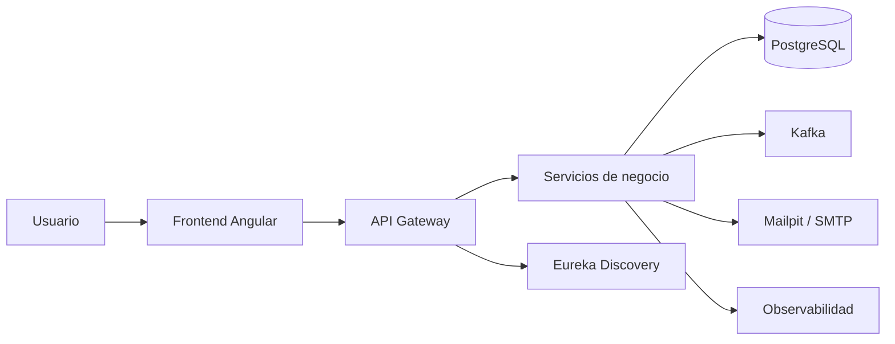

# MediZano POS

Sistema distribuido para la gestión de una botica: ventas, facturación, inventario, compras, clientes, proveedores y control de usuarios.

Proyecto académico de **Desarrollo de Aplicaciones Distribuidas** — UPeU 2026-2.

## Vista general

MediZano utiliza una arquitectura de microservicios con Spring Boot, Angular, PostgreSQL, Eureka, API Gateway y Docker Compose.



## Equipo y distribución

Cada integrante presenta un microservicio **transaccional** y uno **no transaccional**.

| Integrante | Transaccional | No transaccional |
|---|---|---|
| **Aldo Calla** | `orden-ms` — órdenes y ventas | `catalogo-ms` — medicamentos y categorías |
| **Kenyi Calsin** | `inventario-ms` — stock, lotes y movimientos | `cliente-ms` — clientes y pacientes |
| **Igarlos Ruben** | `pago-ms` — cobros y pagos | `usuario-ms` — autenticación, usuarios y roles |
| **Diego Chambilla** | `facturacion-ms` — boletas y facturas | `proveedor-ms` — laboratorios y proveedores |

### Diferencia entre ambos tipos

- **Transaccional:** registra operaciones que cambian el estado del negocio, como una venta, un pago, una recepción o un movimiento de stock.
- **No transaccional:** administra información maestra, consultas, identidad o datos de referencia. No debe modificar directamente la base de datos de otro servicio.

## Microservicios

| Servicio | Puerto interno | Responsabilidad |
|---|---:|---|
| `catalogo-ms` | 8081 | Medicamentos, categorías y datos maestros |
| `orden-ms` | 8082 | Órdenes de venta y flujo POS |
| `pago-ms` | 8083 | Pagos y estados de cobro |
| `cliente-ms` | 8084 | Clientes, pacientes y documentos |
| `inventario-ms` | 8085 | Stock, lotes, vencimientos y kardex FEFO |
| `facturacion-ms` | 8086 | Boletas, facturas, IGV y reembolsos |
| `usuario-ms` | 8087 | Login, JWT, usuarios, roles y auditoría |
| `proveedor-ms` | 8088 | Proveedores, laboratorios y abastecimiento |

Cada microservicio mantiene su propia responsabilidad y accede a su base de datos correspondiente. Las comunicaciones entre servicios se realizan mediante APIs y eventos, no mediante acceso directo a tablas ajenas.

## Roles del sistema

| Usuario | Función principal |
|---|---|
| `admin` | Administración completa, usuarios, auditoría e historial de accesos |
| `cajero` | Ventas, pagos y comprobantes en el POS |
| `inventario` | Stock, lotes, vencimientos y kardex |
| `almacen` | Compras, recepción y escaneo de productos |
| `soporte` | Atención al cliente y devoluciones |
| `analista` | Reportes y consultas de solo lectura |
| `gerente` | Supervisión, compras, inventario, reportes y aprobaciones |

La aplicación utiliza `AuthGuard` y `RoleGuard` en el frontend. El administrador conserva los accesos de usuarios y auditoría; los demás perfiles solo visualizan los módulos necesarios para su trabajo.

## Estructura del repositorio

```text
MediZano_microservicios/
├── clients/
│   └── medizano-frontend/       # Angular 17 + Nginx
├── services/
│   ├── medizano-catalogo-ms/
│   ├── medizano-cliente-ms/
│   ├── medizano-facturacion-ms/
│   ├── medizano-inventario-ms/
│   ├── medizano-orden-ms/
│   ├── medizano-pago-ms/
│   ├── medizano-proveedor-ms/
│   └── medizano-usuario-ms/
├── infra/
│   ├── medizano-eureka/
│   └── medizano-gateway/
├── monitoring/                  # Prometheus, Loki y Grafana
├── docs/                        # Documentación técnica
├── docker-compose.yml
├── init-microservices-db.sql
└── README.md
```

## Tecnologías

- Java 17 y Spring Boot 3.
- Spring Cloud Gateway y Eureka Discovery.
- Angular 17 y Nginx.
- PostgreSQL 16, una base por microservicio.
- Apache Kafka para eventos asíncronos.
- Docker Compose para ejecución local.
- JWT y BCrypt para autenticación.
- Prometheus, Loki y Grafana para observabilidad.
- Mailpit como simulador SMTP para pruebas de correo.

## Requisitos

- Docker Desktop y Docker Compose.
- JDK 17 o superior.
- Maven 3.9 o superior.
- Node.js 18 o superior para desarrollo del frontend.
- Git.

## Configuración

Crear el archivo `.env` a partir de la plantilla disponible:

```bash
cp .env.example .env
```

Completar las variables obligatorias, especialmente la contraseña de PostgreSQL y la clave JWT. No subir `.env`, contraseñas, certificados privados ni claves SSH al repositorio.

## Ejecución con Docker

```bash
docker compose up -d --build
docker compose ps
```

Para detener la plataforma:

```bash
docker compose down
```

Para consultar logs:

```bash
docker compose logs -f frontend
docker compose logs -f api-gateway
```

## Accesos locales

| Componente | URL |
|---|---|
| Aplicación web | `http://localhost:4200` |
| API Gateway / Swagger | `http://localhost:8090/swagger-ui.html` |
| Eureka | `http://localhost:8761` |
| Mailpit Webmail | `http://localhost:8025` |
| Kafka UI | `http://localhost:18085` |
| Prometheus | `http://localhost:9090` |
| Grafana | `http://localhost:3000` |

Los microservicios de negocio se exponen internamente en la red Docker y se consumen a través del API Gateway.

## Flujos principales

### Venta en POS

1. El cajero busca o escanea un medicamento.
2. `orden-ms` registra la orden y consulta disponibilidad.
3. `inventario-ms` reserva o descuenta el lote FEFO correspondiente.
4. `pago-ms` procesa el método de pago.
5. `facturacion-ms` emite el comprobante.
6. `usuario-ms` registra la actividad del usuario.

### Compra y recepción

1. Almacén registra la orden al proveedor.
2. Se realiza el seguimiento del pedido.
3. Se escanean los productos recibidos.
4. `inventario-ms` crea los lotes y actualiza el stock.

### Reembolso

Los reembolsos se registran con su propia fecha de procesamiento. Por eso, un reembolso realizado al día siguiente aparece en la caja del día siguiente y no modifica retroactivamente el cierre original.

## Reportes y auditoría

- **Caja diaria:** ventas cobradas, reembolsos del periodo y neto de caja.
- **Reporte de ventas:** comprobantes, importes, IGV y métodos de pago.
- **Reporte de stock:** existencias, lotes, vencimientos y valorización.
- **Actividad de usuarios:** ventas, reembolsos, compras, cambios de inventario y otras operaciones.
- **Historial de accesos:** únicamente inicio y cierre de sesión.

## Reglas de arquitectura

- Cada microservicio es dueño de sus datos.
- No se comparten entidades ni tablas entre bases de datos.
- Las integraciones se realizan mediante REST, Feign o eventos Kafka.
- El frontend no reemplaza la autorización del backend.
- Las credenciales reales se manejan mediante variables de entorno.
- Los cambios operativos importantes deben quedar registrados en auditoría.

## Documentación adicional

- [`docs/`](docs/)
- [`docker-compose.yml`](docker-compose.yml)
- [`clients/medizano-frontend/`](clients/medizano-frontend/)
- [`services/`](services/)

## Repositorio

[github.com/rbn-69-cod/MediZano_microservicios](https://github.com/rbn-69-cod/MediZano_microservicios)
