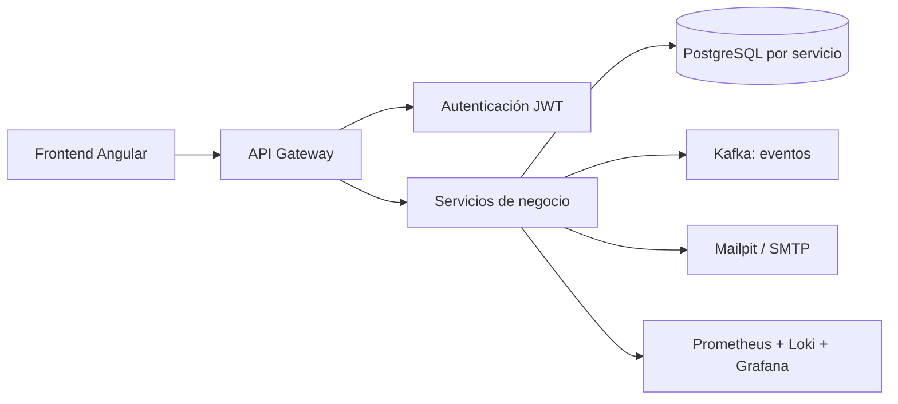
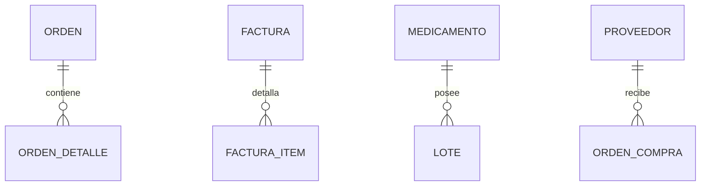
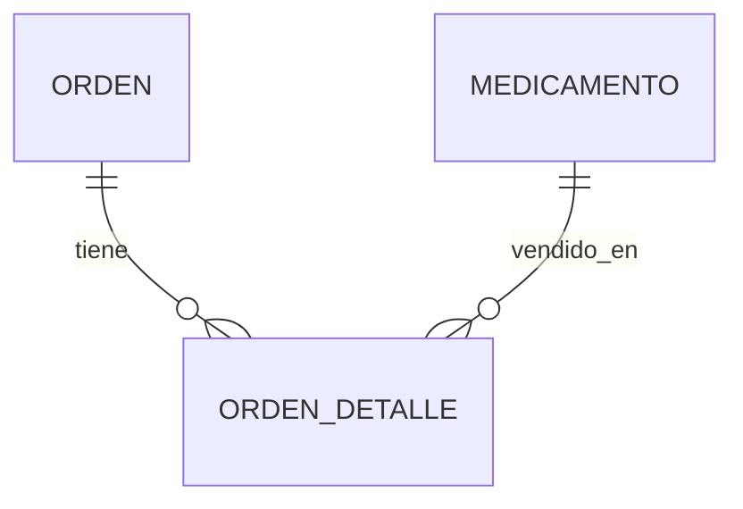

# MediZano POS

## Sistema distribuido para una botica moderna

MediZano POS es una plataforma web para administrar ventas, facturación, inventario, compras, clientes y seguridad de una botica. El proyecto fue construido por estudiantes aplicando principios de arquitectura distribuida, separación de responsabilidades, comunicación entre servicios y despliegue en AWS.

> **Demo desplegada:** [Abrir MediZano en AWS](http://54.226.25.238/)
>
> La IP pública de EC2 puede cambiar. Si la URL deja de responder después de reiniciar la instancia, reemplaza el host por la nueva IP pública en el selector de enlaces de esta página.

## Accesos rápidos

<div class="host-switcher-card" style="background:var(--md-code-bg-color);border:2px solid #0d9488;border-radius:16px;padding:22px;margin:20px 0;box-shadow:0 8px 24px rgba(15,23,42,.10);">
<div style="display:flex;justify-content:space-between;align-items:center;gap:12px;flex-wrap:wrap;">
<div><strong style="font-size:1.15rem;">🌐 Entorno activo</strong><br><small>Selecciona AWS o localhost. También puedes ingresar una nueva IP.</small></div>
<code id="medizano-current-host-display">Detectando...</code>
</div>
<div style="display:flex;gap:8px;flex-wrap:wrap;margin:18px 0;">
<button id="btn-host-auto" type="button">☁️ Usar host actual</button>
<button id="btn-host-local" type="button">💻 Usar localhost</button>
<input id="medizano-custom-ip-input" type="text" placeholder="54.226.25.238" style="flex:1;min-width:220px;padding:9px;border:1px solid #cbd5e1;border-radius:8px;">
<button id="btn-host-save" type="button">Guardar host</button>
</div>
<div style="display:grid;grid-template-columns:repeat(auto-fit,minmax(210px,1fr));gap:10px;">
<a data-service-port="80" data-service-path="/" href="http://54.226.25.238/" target="_blank">🛒 Aplicación web<div class="service-url-badge">http://54.226.25.238/</div></a>
<a data-service-port="8090" data-service-path="/swagger-ui.html" href="http://54.226.25.238:8090/swagger-ui.html" target="_blank">📑 Swagger / API Gateway<div class="service-url-badge">http://54.226.25.238:8090/swagger-ui.html</div></a>
<a data-service-port="8761" data-service-path="/" href="http://54.226.25.238:8761/" target="_blank">🔭 Eureka Discovery<div class="service-url-badge">http://54.226.25.238:8761/</div></a>
<a data-service-port="8025" data-service-path="/" href="http://54.226.25.238:8025/" target="_blank">📬 Mailpit Webmail<div class="service-url-badge">http://54.226.25.238:8025/</div></a>
<a data-service-port="18085" data-service-path="/" href="http://54.226.25.238:18085/" target="_blank">📨 Kafka UI<div class="service-url-badge">http://54.226.25.238:18085/</div></a>
<a data-service-port="3000" data-service-path="/" href="http://54.226.25.238:3000/" target="_blank">📊 Grafana<div class="service-url-badge">http://54.226.25.238:3000/</div></a>
</div>
</div>

## ¿Qué problema resolvemos?

Una botica necesita vender rápido, controlar lotes y vencimientos, evitar duplicar pagos, emitir comprobantes y saber quién realizó cada operación. MediZano reúne esas capacidades en servicios independientes que se comunican mediante APIs y eventos.


## Cómo construimos la solución



1. Diseñamos el dominio de la botica y separamos responsabilidades.
2. Creamos servicios Spring Boot independientes con su propia persistencia.
3. Registramos los servicios con Eureka y centralizamos la entrada con API Gateway.
4. Usamos REST/Feign para consultas síncronas y Kafka para eventos asíncronos.
5. Añadimos JWT, RBAC, circuit breaker, idempotencia y compensaciones.
6. Construimos el frontend Angular y lo empaquetamos con Nginx.
7. Contenerizamos la plataforma y la desplegamos en una instancia AWS EC2.
8. Añadimos observabilidad y documentación interactiva con MkDocs.

## Los ocho servicios del proyecto

| Tipo | Servicio | Qué resuelve |
|---|---|---|
| Transaccional | Ventas y Facturación | Ordenes, pagos, comprobantes, IGV y reembolsos |
| No transaccional | Catálogo | Medicamentos, categorías y datos maestros |
| Transaccional | Inventario y Lotes | Stock, kardex, lotes y vencimientos FEFO |
| No transaccional | Reportes y Analítica | Lectura consolidada de ventas, caja y stock |
| Transaccional | Compras y Abastecimiento | Pedidos, proveedores, recepción y entrada de stock |
| No transaccional | Notificaciones y Correos | Comprobantes, avisos y correo SMTP de prueba |
| Transaccional | Usuarios y Autenticación | Usuarios, roles, contraseñas y sesiones |
| No transaccional | Auditoría y Actividad | Trazabilidad de operaciones e historial de accesos |

La asignación académica está detallada en [Proyecto Sello](proyecto-sello/index.md). Los nombres técnicos de las carpetas y servicios existentes se explican en [Alcance por microservicio](proyecto-sello/alcance-microservicios.md).

## Código fuente

Cada enlace abre directamente la carpeta correspondiente en GitHub:

| Área | Código |
|---|---|
| Frontend Angular | [clients/medizano-frontend](https://github.com/rbn-69-cod/MediZano_microservicios/tree/main/clients/medizano-frontend) |
| Servicios de negocio | [services/](https://github.com/rbn-69-cod/MediZano_microservicios/tree/main/services) |
| Eureka y Gateway | [infra/](https://github.com/rbn-69-cod/MediZano_microservicios/tree/main/infra) |
| Docker Compose | [docker-compose.yml](https://github.com/rbn-69-cod/MediZano_microservicios/blob/main/docker-compose.yml) |
| Despliegue AWS | [deploy/](https://github.com/rbn-69-cod/MediZano_microservicios/tree/main/deploy) |
| Observabilidad | [obs/](https://github.com/rbn-69-cod/MediZano_microservicios/tree/main/obs) |
| Configuración Kafka | [kafka/](https://github.com/rbn-69-cod/MediZano_microservicios/tree/main/kafka) |

## Relaciones de datos

### Relación uno a muchos (1:N)

Una orden tiene muchos detalles; una factura tiene muchos ítems; un medicamento puede tener muchos lotes.



La clave foránea se mantiene dentro del servicio propietario. Por ejemplo, `orden_detalle.orden_id` pertenece a `orden-ms`; otro servicio consulta mediante API, pero no hace JOIN directo a esa tabla.

### Relación muchos a muchos (N:M)

Una orden puede incluir muchos medicamentos y un medicamento puede aparecer en muchas órdenes. En lugar de una relación N:M directa, usamos una entidad intermedia: `orden_detalle`.



Esta entidad intermedia guarda cantidad, precio y subtotal. Es la forma correcta de conservar el historial de cada venta sin duplicar información.

## Despliegue en AWS

La plataforma se ejecuta en una instancia EC2 mediante Docker Compose:

```text
Internet
   │
   ▼
AWS EC2 + Security Group
   ├── Nginx / Frontend :80 y :443
   ├── MkDocs :8000
   ├── API Gateway :8090
   ├── Eureka :8761
   ├── Mailpit :8025
   ├── Kafka UI :18085
   └── Servicios internos + PostgreSQL + Kafka
```

La documentación se abre en:

```text
http://<IP_PUBLICA_EC2>:8000/medizano/
```

Para actualizar la IP mostrada por los enlaces, se utiliza el selector de esta página. Para una URL permanente se recomienda asociar una Elastic IP o un dominio mediante Route 53.

## Evidencias del sistema

### Aplicación web y POS


### Descubrimiento de servicios


### Eventos asíncronos


### Observabilidad


### API documentada


## Rutas de documentación

La navegación completa está organizada en el menú superior de MkDocs:

- [Proyecto Sello](proyecto-sello/index.md)
- [Guía de exposición](proyecto-sello/guia-exposicion.md)
- [Producto de Unidad 1](proyecto-sello/u1-producto.md)
- [Producto de Unidad 2](proyecto-sello/u2-producto.md)
- [Alcance por microservicio](proyecto-sello/alcance-microservicios.md)
- [Guía de construcción](proyecto-sello/guia-construccion-paso-a-paso.md)

Para ejecutar la documentación localmente:

```bash
mkdocs serve --dev-addr 0.0.0.0:8000
```
