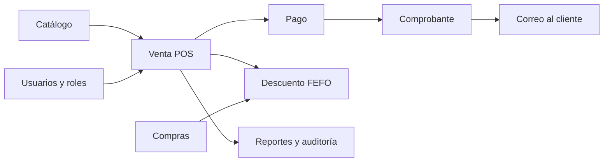
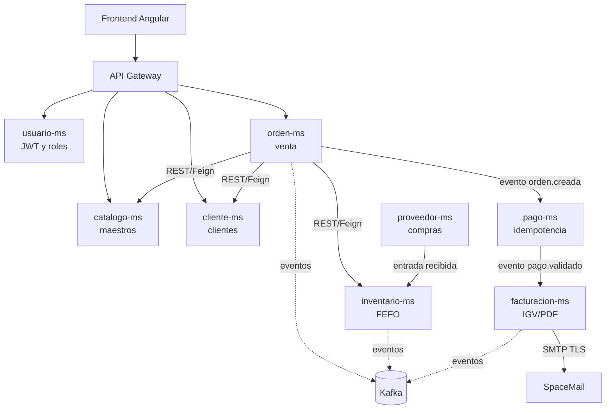
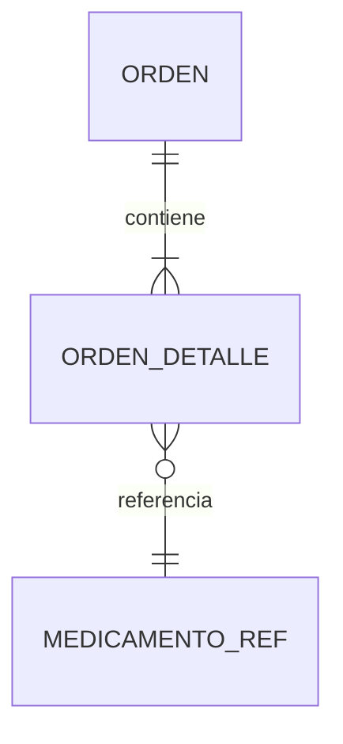
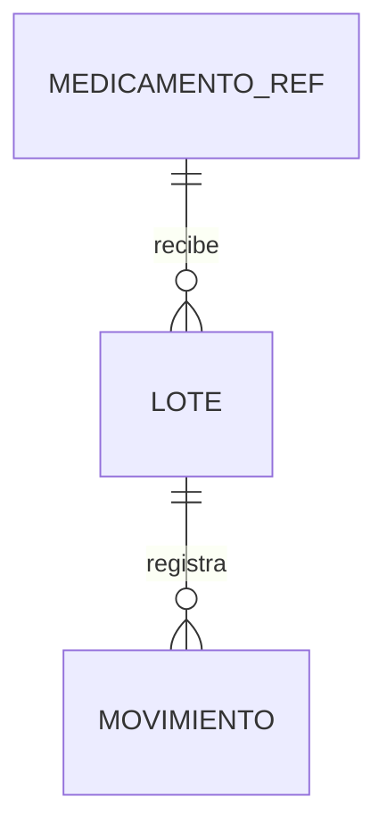
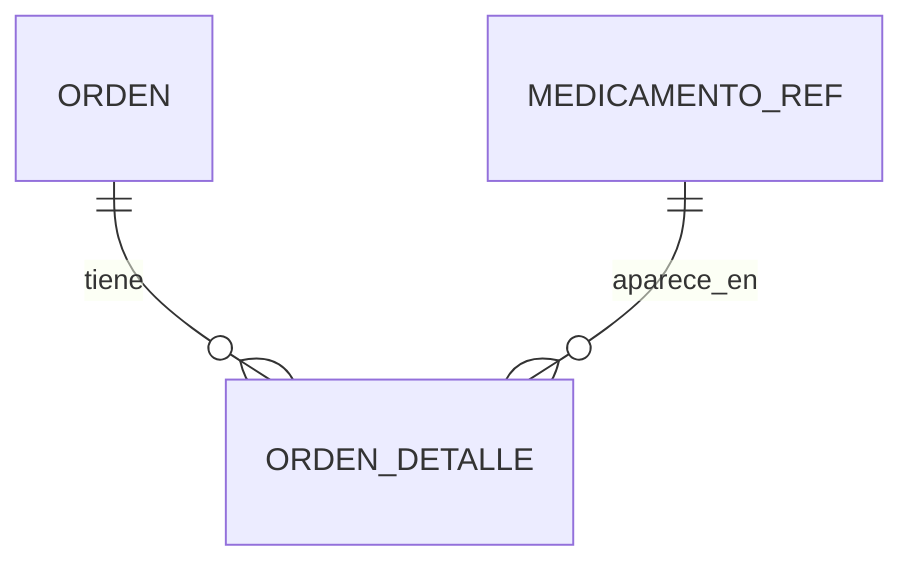

# Alcance por Microservicio y Arquitectura de Datos: MediZano POS

Este documento especifica la infraestructura técnica, esquemas de bases de datos, migraciones versionadas (Flyway), configuración y principios de diseño para los **8 microservicios** de MediZano POS.

---

## Resumen ejecutivo: ¿qué alcance tiene MediZano?

MediZano no es únicamente un CRUD de medicamentos. Es una plataforma distribuida que cubre el ciclo operativo de una botica:



### El alcance sí incluye

| Área | Capacidad implementada | Valor para la botica |
|---|---|---|
| Operación comercial | Venta POS, carrito, cliente, pago y comprobante | Reduce errores en mostrador y deja trazabilidad de la venta. |
| Control farmacéutico | Lotes, vencimientos, kardex y regla FEFO | Ayuda a despachar primero lo que vence antes. |
| Abastecimiento | Proveedores, órdenes de compra, recepción y entrada de stock | Conecta la compra con la disponibilidad real. |
| Seguridad | Login, JWT, roles, sesiones y permisos por módulo | Cada usuario ve y ejecuta solo lo que corresponde a su rol. |
| Integración | REST/Feign para respuestas inmediatas y Kafka para eventos | Evita acoplar todos los procesos en una sola aplicación. |
| Comunicación | Comprobantes y alertas mediante SpaceMail SMTP autenticado | El cliente recibe el comprobante en un correo real. |
| Observabilidad | Actuator, Prometheus, Loki y Grafana | Permite detectar errores y medir el estado de la plataforma. |
| Despliegue | Docker Compose sobre AWS EC2 y documentación MkDocs | El entorno se puede levantar de forma reproducible. |

### El alcance no incluye

Para no prometer funcionalidades que no forman parte de esta entrega, quedan fuera: integración directa con SUNAT en producción, facturación electrónica certificada, pagos bancarios reales, aplicación móvil nativa, reparto a domicilio y una base de datos compartida entre microservicios. Estas capacidades podrían agregarse como una siguiente versión sin cambiar la separación principal.

## Qué hace cada microservicio y dónde termina su responsabilidad

La regla central es simple: **cada servicio es dueño de su información**. Puede consultar a otro servicio mediante API o reaccionar a un evento, pero no modifica sus tablas ni crea `JOIN` entre bases de datos ajenas.

| Servicio | Se encarga de | Recibe / publica | No debe hacer |
|---|---|---|---|
| `catalogo-ms` | Medicamentos, categorías, presentación, precio y receta | Responde consultas de productos | Descontar stock o registrar ventas |
| `orden-ms` | Cabecera, detalle y estado de la venta | Consulta catálogo/cliente; publica `orden.creada` | Cobrar directamente o administrar lotes |
| `cliente-ms` | DNI/RUC, nombre, correo y contacto | Entrega datos del cliente | Guardar el detalle de una orden |
| `inventario-ms` | Lotes, existencias, kardex y FEFO | Reserva stock y publica movimientos | Emitir comprobantes |
| `pago-ms` | Intento de cobro, estado e idempotencia | Consume orden y responde resultado | Cambiar el stock sin autorización del inventario |
| `facturacion-ms` | Boletas, facturas, IGV y PDF | Consume pago aprobado; solicita correo | Administrar usuarios o productos maestros |
| `proveedor-ms` | Proveedores, compras y recepción | Genera entradas para inventario | Alterar directamente la base de inventario |
| `usuario-ms` | Credenciales, roles, JWT y sesiones | Autentica y autoriza peticiones | Contener reglas de ventas o stock |

## Mapa de comunicación y propiedad de datos



## Relaciones de datos que sí demostramos

### Relación 1:N — una orden tiene muchos detalles



Una orden (`orden`) puede contener varios detalles (`orden_detalle`). El detalle conserva cantidad, precio unitario y subtotal para que la venta histórica no cambie aunque el precio del catálogo se actualice después.

### Relación 1:N — un medicamento tiene muchos lotes



El catálogo identifica el medicamento y el inventario administra sus lotes. Cada lote conserva vencimiento y stock; los movimientos registran entrada, salida, ajuste o compensación.

### Relación N:M — orden y medicamento mediante entidad intermedia



La relación N:M no se implementa uniendo bases directamente. `orden_detalle` es la entidad intermedia y guarda los atributos propios de la asociación: cantidad, precio, subtotal y nombre congelado del producto.

### Ventaja de este diseño

Si `catalogo-ms` cambia el precio de un medicamento, las ventas antiguas conservan su importe. Si `inventario-ms` registra una devolución, el kardex mantiene el movimiento y `orden-ms` conserva el historial comercial. Esta separación protege la consistencia y facilita auditar cada decisión.

## Fortalezas del proyecto

### 1. Separación real, no solo carpetas

Los servicios se ejecutan como contenedores independientes, se registran en Eureka y tienen responsabilidades delimitadas. La separación se respeta también en la persistencia: **Database per Service**.

### 2. Flujo de venta resistente a fallos

La venta combina llamadas síncronas cuando se necesita una respuesta inmediata y eventos Kafka cuando el siguiente paso puede continuar desacoplado. Resilience4j permite aplicar timeout, circuit breaker y fallback ante dependencias no disponibles.

### 3. Trazabilidad farmacéutica

El lote no es un dato decorativo: participa en el descuento FEFO, en el kardex y en las devoluciones. Esto permite explicar qué cantidad salió, de qué lote y por qué motivo.

### 4. Seguridad y responsabilidades por usuario

El Gateway valida la entrada, `usuario-ms` gestiona identidad y los roles limitan módulos y operaciones. La actividad operativa se registra separada del historial de inicio y cierre de sesión.

### 5. Evidencia observable

La sustentación no depende solo del código: Swagger prueba contratos, Eureka muestra instancias, Kafka muestra eventos y Grafana/Prometheus muestran el comportamiento del sistema.

## Cómo defender el alcance en la exposición

1. Presentar el problema de la botica: vender, controlar vencimientos, comprar y auditar.
2. Mostrar el mapa de servicios y señalar quién es dueño de cada dato.
3. Ejecutar una venta: catálogo → orden → stock FEFO → pago → comprobante → SpaceMail.
4. Abrir Swagger o Kafka para demostrar la comunicación entre servicios.
5. Mostrar una relación 1:N y una N:M con sus entidades intermedias.
6. Cerrar explicando qué queda fuera y cómo podría crecer el proyecto sin romper los límites actuales.

---

## 1. Principio Fundamental: Base de Datos por Microservicio (*Database per Service*)

Cada microservicio gestiona su propia base de datos PostgreSQL aislada. **Queda estrictamente prohibido crear llaves foráneas (`FOREIGN KEY / REFERENCES`) entre bases de datos de microservicios distintos**:
* `oóordenes.id_cliente` almacena el ID del cliente registrado en `cliente-ms` como un simple `BIGINT`. La integridad referencial se valida mediante **llamadas síncronas REST / Feign en tiempo de ejecución**, no a nivel SQL.
* `oorden_detalles.id_medicamento` almacena el ID del producto registrado en `catalogo-ms` o `inventario-ms`.

---

## 2. Mapa Integral de Puertos y Bases de Datos (DEV y Docker)

| Microservicio | Tipo | Responsable | Puerto DEV | Base de Datos PostgreSQL | Contenedor Docker |
| :--- | :--- | :--- | :---: | :--- | :--- |
| **`orden-ms`** | Transaccional | **Aldo Calla** | `8082` | `medizano_ordenes_db` | `medizano-orden-ms` |
| **`cliente-ms`** | No Transaccional | **Kenyi Calsin** | `8084` | `medizano_clientes_db` | `medizano-cliente-ms` |
| **`inventario-ms`** | Transaccional | **Kenyi Calsin** | `8085` | `medizano_inventario_db` | `medizano-inventario-ms` |
| **`catalogo-ms`** | No Transaccional | **Aldo Calla** | `8081` | `medizano_catalogo_db` | `medizano-catalogo-ms` |
| **`pago-ms`** | Transaccional | **Diego Chambilla** | `8083` | `medizano_pagos_db` | `medizano-pago-ms` |
| **`usuario-ms`** | No Transaccional | **Diego Chambilla** | `8087` | `medizano_usuarios_db` | `medizano-usuario-ms` |
| **`facturacion-ms`** | Transaccional | **Igarlos Ruben** | `8086` | `medizano_facturacion_db` | `medizano-facturacion-ms` |
| **`proveedor-ms`** | Transaccional | **Igarlos Ruben** | `8088` | `medizano_proveedores_db` | `medizano-proveedor-ms` |

---

## 3. Esquemas de Base de Datos y Migraciones SQL (Flyway)

---

### 3.1. `catalogo-ms` (No Transaccional · Aldo Calla)
Gestiona medicamentos, presentaciones y categorías farmacéuticas.

```sql
-- V1__create_catalogo_tables.sql
CREATE TABLE IF NOT EXISTS categorias (
    id BIGINT GENERATED BY DEFAULT AS IDENTITY PRIMARY KEY,
    nombre VARCHAR(100) NOT NULL UNIQUE,
    descripcion TEXT
);

CREATE TABLE IF NOT EXISTS medicamentos (
    id BIGINT GENERATED BY DEFAULT AS IDENTITY PRIMARY KEY,
    nombre_comercial VARCHAR(150) NOT NULL,
    principio_activo VARCHAR(150) NOT NULL,
    concentracion VARCHAR(50),
    forma_farmaceutica VARCHAR(50), -- Tableta, Jarabe, Crema
    categoria_id BIGINT REFERENCES categorias(id),
    precio_venta NUMERIC(10,2) NOT NULL,
    requiere_receta BOOLEAN NOT NULL DEFAULT false,
    activo BOOLEAN NOT NULL DEFAULT true,
    fecha_creacion TIMESTAMP DEFAULT now()
);
```

---

### 3.2. `orden-ms` (Transaccional · Aldo Calla)
Gestiona la oorden de venta POS con estructura cabecera-detalle.

```sql
-- V1__create_oorden_tables.sql
CREATE TABLE IF NOT EXISTS oóordenes (
    id BIGINT GENERATED BY DEFAULT AS IDENTITY PRIMARY KEY,
    id_cliente BIGINT, -- Sin FK: apunta a cliente-ms
    nombre_cliente VARCHAR(150),
    tipo_comprobante VARCHAR(20) NOT NULL DEFAULT 'BOLETA', -- BOLETA, FACTURA
    metodo_pago VARCHAR(30) NOT NULL, -- MERCADOPAGO, PAYPAL, EFECTIVO
    estado VARCHAR(30) NOT NULL DEFAULT 'PENDIENTE_PAGO', -- PENDIENTE_PAGO, PAGADA, CANCELADA
    total NUMERIC(10,2) NOT NULL,
    fecha_creacion TIMESTAMP NOT NULL DEFAULT now()
);

CREATE TABLE IF NOT EXISTS oorden_detalles (
    id BIGINT GENERATED BY DEFAULT AS IDENTITY PRIMARY KEY,
    id_oorden BIGINT NOT NULL REFERENCES oóordenes(id) ON DELETE CASCADE,
    id_medicamento BIGINT NOT NULL, -- Sin FK: apunta a catalogo-ms
    nombre_medicamento VARCHAR(150) NOT NULL,
    cantidad INTEGER NOT NULL,
    precio_unitario NUMERIC(10,2) NOT NULL,
    subtotal NUMERIC(10,2) NOT NULL
);
```

---

### 3.3. `cliente-ms` (No Transaccional · Kenyi Calsin)
Gestiona los datos de los pacientes/clientes y documentos de identidad.

```sql
-- V1__create_cliente_tables.sql
CREATE TABLE IF NOT EXISTS clientes (
    id BIGINT GENERATED BY DEFAULT AS IDENTITY PRIMARY KEY,
    tipo_persona VARCHAR(10) NOT NULL, -- NATURAL, JURIDICA
    dni VARCHAR(8) UNIQUE,
    ruc VARCHAR(11) UNIQUE,
    nombre_completo VARCHAR(150),
    razon_social VARCHAR(150),
    direccion VARCHAR(255),
    email VARCHAR(150),
    telefono_whatsapp VARCHAR(20),
    fecha_registro TIMESTAMP DEFAULT now()
);
```

---

### 3.4. `pago-ms` (Transaccional · Diego Chambilla)
Gestiona el procesamiento del cobro con pasarelas externas reales e idempotencia en dos niveles.

```sql
-- V1__create_pago_tables.sql
CREATE TABLE IF NOT EXISTS pagos (
    id BIGINT GENERATED BY DEFAULT AS IDENTITY PRIMARY KEY,
    oorden_id BIGINT NOT NULL,
    metodo_pago VARCHAR(30) NOT NULL,
    monto NUMERIC(10,2) NOT NULL,
    moneda VARCHAR(5) NOT NULL DEFAULT 'PEN',
    estado VARCHAR(30) NOT NULL DEFAULT 'PENDIENTE', -- PENDIENTE, VALIDADO, FALLIDO
    transaccion_externa_id VARCHAR(100),
    fecha_pago TIMESTAMP DEFAULT now(),
    CONSTRAINT uk_pagos_oorden UNIQUE (oorden_id) -- Garantía de Idempotencia a nivel BD
);
```

---

### 3.5. `usuario-ms` (No Transaccional · Diego Chambilla)
Servidor de autenticación local y gestión de credenciales con roles.

```sql
-- V1__create_usuario_tables.sql
CREATE TABLE IF NOT EXISTS usuarios (
    id BIGINT GENERATED BY DEFAULT AS IDENTITY PRIMARY KEY,
    username VARCHAR(50) NOT NULL UNIQUE,
    password_hash VARCHAR(255) NOT NULL,
    email VARCHAR(150) NOT NULL UNIQUE,
    nombre_completo VARCHAR(150) NOT NULL,
    rol VARCHAR(30) NOT NULL DEFAULT 'ROLE_CLIENTE', -- ROLE_ADMIN, ROLE_FARMACEUTICO, ROLE_CLIENTE
    activo BOOLEAN NOT NULL DEFAULT true,
    fecha_registro TIMESTAMP DEFAULT now()
);
```

---

### 3.6. `facturacion-ms` (Transaccional · Igarlos Ruben)
Emisión de comprobantes electrónicos legales (Boletas y Facturas) con cálculo de impuestos.

```sql
-- V1__create_facturacion_tables.sql
CREATE TABLE IF NOT EXISTS facturas (
    id BIGINT GENERATED BY DEFAULT AS IDENTITY PRIMARY KEY,
    oorden_id BIGINT NOT NULL UNIQUE,
    tipo_comprobante VARCHAR(20) NOT NULL, -- BOLETA, FACTURA
    serie VARCHAR(4) NOT NULL,             -- B001, F001
    correlativo INTEGER NOT NULL,          -- 1, 2, 3...
    id_cliente BIGINT NOT NULL,
    nombre_receptor VARCHAR(150) NOT NULL,
    num_documento VARCHAR(15) NOT NULL,
    subtotal NUMERIC(10,2) NOT NULL,
    igv NUMERIC(10,2) NOT NULL,
    total NUMERIC(10,2) NOT NULL,
    estado VARCHAR(20) NOT NULL DEFAULT 'EMITIDO',
    fecha_emision TIMESTAMP DEFAULT now(),
    CONSTRAINT uk_serie_correlativo UNIQUE (serie, correlativo)
);

CREATE TABLE IF NOT EXISTS factura_items (
    id BIGINT GENERATED BY DEFAULT AS IDENTITY PRIMARY KEY,
    factura_id BIGINT NOT NULL REFERENCES facturas(id) ON DELETE CASCADE,
    id_medicamento BIGINT NOT NULL,
    descripcion VARCHAR(150) NOT NULL,
    cantidad INTEGER NOT NULL,
    precio_unitario NUMERIC(10,2) NOT NULL,
    subtotal NUMERIC(10,2) NOT NULL,
    igv_linea NUMERIC(10,2) NOT NULL
);
```

---

### 3.7. `proveedor-ms` (Transaccional · Igarlos Ruben)
Gestiona de laboratorios y empresas proveedoras de suministros médicos.

```sql
-- V1__create_proveedor_tables.sql
CREATE TABLE IF NOT EXISTS proveedores (
    id BIGINT GENERATED BY DEFAULT AS IDENTITY PRIMARY KEY,
    ruc VARCHAR(11) NOT NULL UNIQUE,
    razon_social VARCHAR(150) NOT NULL,
    nombre_comercial VARCHAR(150),
    direccion_fiscal VARCHAR(255),
    telefono_contacto VARCHAR(20),
    email_contacto VARCHAR(150),
    registro_digemid VARCHAR(50),
    activo BOOLEAN NOT NULL DEFAULT true,
    fecha_registro TIMESTAMP DEFAULT now()
);
```

---

### 3.8. `inventario-ms` (Transaccional · Kenyi Calsin)
Control transaccional de movimientos Kardex y Lotes con fecha de vencimiento (FEFO).

```sql
-- V1__create_inventario_tables.sql
CREATE TABLE IF NOT EXISTS lotes (
    id BIGINT GENERATED BY DEFAULT AS IDENTITY PRIMARY KEY,
    medicamento_id BIGINT NOT NULL,
    numero_lote VARCHAR(50) NOT NULL,
    fecha_vencimiento DATE NOT NULL,
    stock_actual INTEGER NOT NULL CHECK (stock_actual >= 0),
    CONSTRAINT uk_medicamento_lote UNIQUE (medicamento_id, numero_lote)
);

CREATE TABLE IF NOT EXISTS movimientos_inventario (
    id BIGINT GENERATED BY DEFAULT AS IDENTITY PRIMARY KEY,
    tipo_movimiento VARCHAR(30) NOT NULL, -- ENTRADA_COMPRA, SALIDA_VENTA, AJUSTE_MERMA, COMPENSACION
    origen_destino VARCHAR(150),
    usuario_id BIGINT,
    motivo TEXT,
    fecha_movimiento TIMESTAMP DEFAULT now()
);

CREATE TABLE IF NOT EXISTS movimiento_detalles (
    id BIGINT GENERATED BY DEFAULT AS IDENTITY PRIMARY KEY,
    movimiento_id BIGINT NOT NULL REFERENCES movimientos_inventario(id) ON DELETE CASCADE,
    medicamento_id BIGINT NOT NULL,
    lote_id BIGINT REFERENCES lotes(id),
    cantidad INTEGER NOT NULL,
    stock_anterior INTEGER NOT NULL,
    stock_posterior INTEGER NOT NULL
);
```

