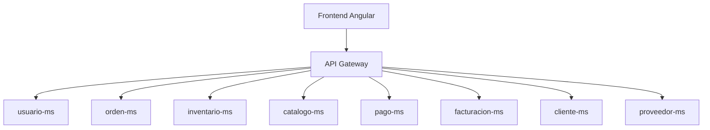
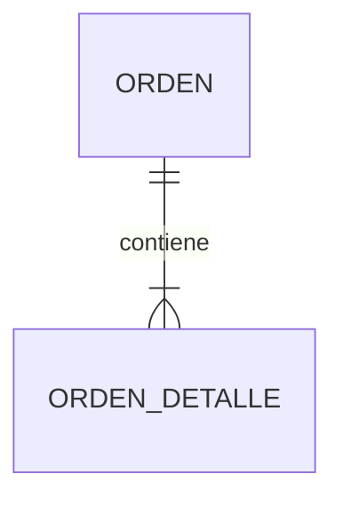
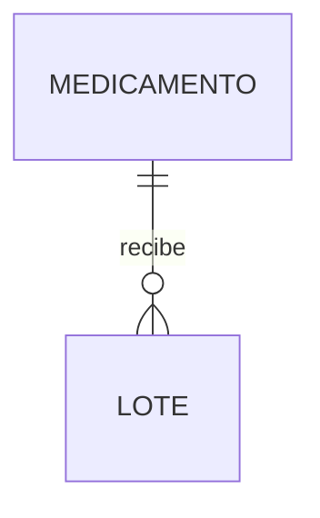
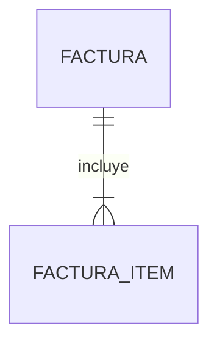
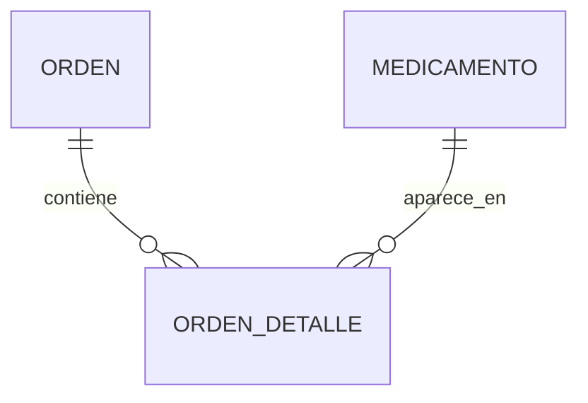
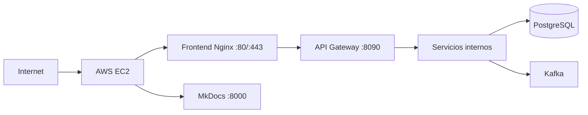
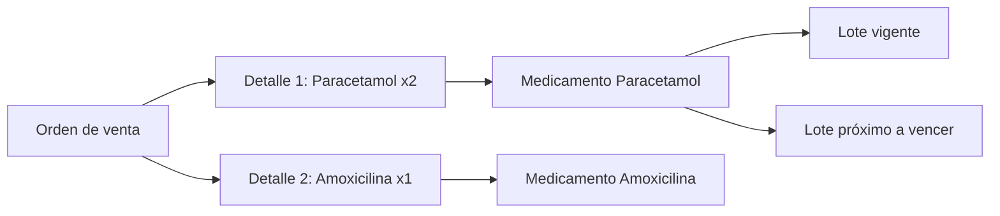

# Arquitectura, relaciones y despliegue

## Límites de los servicios



Cada servicio tiene una responsabilidad y una persistencia propia. El Gateway enruta las peticiones; no contiene reglas del negocio.

## Relaciones uno a muchos

### Orden y detalles

Una orden tiene uno o muchos detalles. Cada detalle identifica un medicamento, cantidad, precio y subtotal.



La relación se resuelve con `orden_detalle.orden_id`. El detalle no se guarda en una tabla del catálogo porque pertenece al historial de la venta.

### Medicamento y lotes

Un medicamento puede tener muchos lotes porque se recibe en fechas y compras diferentes.



Cada lote conserva fecha de vencimiento, cantidad, costo y precio. El algoritmo FEFO selecciona primero el lote que vence antes.

### Factura e ítems

Una factura posee muchos ítems y cada ítem conserva el precio que tenía al momento de venderse.



## Relaciones muchos a muchos

Una orden puede incluir muchos medicamentos y un medicamento puede estar presente en muchas órdenes. Es una relación N:M.



La tabla `orden_detalle` es la entidad intermedia. Gracias a ella podemos guardar atributos propios de la relación: cantidad, precio unitario, descuento y subtotal.

La misma idea se aplica a:

```text
Factura       N:M Medicamento  -> factura_item
Orden compra  N:M Medicamento  -> orden_compra_detalle
Usuario       N:M Rol          -> usuario_rol, si se habilitan múltiples roles
```

## Comunicación entre microservicios

### Síncrona

Se utiliza cuando el servicio necesita una respuesta inmediata, por ejemplo:

```text
orden-ms -> inventario-ms: verificar y reservar stock
orden-ms -> cliente-ms: validar cliente
frontend -> API Gateway: crear venta o consultar catálogo
```

### Asíncrona

Se utiliza cuando el proceso puede continuar sin bloquear la operación principal:

```text
orden.creada -> pago-ms
pago.validado -> facturacion-ms
factura.emitida -> notificaciones / auditoría
```

## Despliegue en AWS



La URL pública debe usar la IP actual de la instancia. Para evitar cambios de URL se recomienda una Elastic IP o un dominio de Route 53.

## Comandos de despliegue

```bash
docker compose up -d --build
docker compose ps
docker compose logs -f api-gateway
```

La documentación se sirve con:

```bash
mkdocs serve --dev-addr 0.0.0.0:8000
```

Y se consulta en:

```text
http://<IP_PUBLICA_EC2>:8000/medizano/
```

## Cómo leer las relaciones

Una relación **1:N** significa que un registro padre puede tener varios registros hijos. Cada hijo guarda la referencia mediante una clave foránea. Una relación **N:M** significa que muchos registros de un lado se asocian con muchos del otro; se implementa con una entidad intermedia que también guarda atributos propios de la asociación.

### Ejemplo completo de una venta



La orden tiene muchos detalles (**1:N**), mientras que la orden y el medicamento forman una relación **N:M** resuelta por `orden_detalle`. Por eso cada detalle conserva cantidad, precio unitario y subtotal, aunque el medicamento cambie de precio después.

### Regla de integración entre servicios

- El servicio propietario crea y modifica sus datos.
- Otro servicio consulta mediante REST/Feign o recibe un evento Kafka.
- Ningún servicio hace JOIN directo a la base de datos de otro.
- Los reportes leen información consolidada y no alteran transacciones.

Para revisar el buzón utilizado por las notificaciones: [Abrir SpaceMail](https://mail.spacemail.com).
