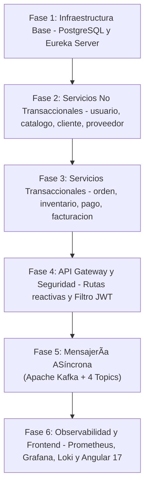

# 🛠️ Guía Paso a Paso: Construcción de MediZano POS desde Cero (Paso a Paso)

> **Propósito:** Esta guía técnica describe con ejemplos reales y comandos reproducibles cómo se construyó el sistema distribuido **MediZano POS**, permitiendo a cualquier desarrollador, estudiante o jurado replicar la arquitectura completa desde cero.

---

## 👥 1. Matriz de Roles y Responsabilidades (4 Integrantes)

Siguiendo la directiva académica oficial (**1 Microservicio Transaccional + 1 Microservicio No Transaccional por integrante**):

| N° | Estudiante | Microservicio Transaccional (Cabecera - Detalle) | Microservicio No Transaccional (Catálogo / Maestro) | Responsabilidad en la Sustentación |
| :---: | :--- | :--- | :--- | :--- |
| **1** | **Kenyi Calsin** | **`orden-ms`** (`:8082`)<br>• Tablas: `ordenes` + `orden_detalles`<br>• Operación POS cabecera-detalle | **`cliente-ms`** (`:8084`)<br>• Tabla: `clientes`<br>• Maestro DNI/RUC con validación | Comunicación Síncrona Resiliente con **OpenFeign** y **Resilience4j Circuit Breaker**. |
| **2** | **Aldo Calla** | **`inventario-ms`** (`:8085`)<br>• Tablas: `movimientos_inventario` + `movimiento_detalles`<br>• Kardex y Lotes FEFO | **`catalogo-ms`** (`:8081`)<br>• Tablas: `medicamentos` + `categorias`<br>• 203 medicamentos maestros | Algoritmo **FEFO** (First Expired, First Out) y trazabilidad farmacéutica DIGEMID. |
| **3** | **Igarlos Mamani** | **`pago-ms`** (`:8083`)<br>• Tablas: `pagos` con idempotencia única<br>• Transacción Mercado Pago / PayPal | **`usuario-ms`** (`:8087`)<br>• Tablas: `usuarios` + `roles`<br>• Servidor de identidad y token JWT | Seguridad perimetral JWT/RBAC y mensajería orientada a eventos con **Apache Kafka**. |
| **4** | **Juan Chambilla** | **`facturacion-ms`** (`:8086`)<br>• Tablas: `facturas` + `factura_items`<br>• Comprobante fiscal con IGV 18% | **`proveedor-ms`** (`:8088`)<br>• Tablas: `proveedores` DIGEMID<br>• Módulo de Compras a Laboratorios | Integración tributaria SUNAT, generación de Boletas/Facturas y Abastecimiento. |

---

## 🏗️ 2. Fases de Construcción del Proyecto (Paso a Paso)



---

### FASE 1: Bases de Datos y Service Discovery

#### 1.1 Esquema Multi-Base de Datos (Database per Service)
Para evitar el acoplamiento monolítico, cada microservicio posee su propia base de datos lógica en PostgreSQL:

```sql
-- init-microservices-db.sql
CREATE DATABASE medizano_usuarios_db;
CREATE DATABASE medizano_catalogo_db;
CREATE DATABASE medizano_inventario_db;
CREATE DATABASE medizano_clientes_db;
CREATE DATABASE medizano_ordenes_db;
CREATE DATABASE medizano_pagos_db;
CREATE DATABASE medizano_facturas_db;
CREATE DATABASE medizano_proveedores_db;
```

#### 1.2 Eureka Server (`medizano-eureka-server` - Puerto 8761)
Permite que los microservicios se descubran dinámicamente por nombre (`http://CATALOGO-MS/`) sin IPs fijas.

```xml
<!-- pom.xml -->
<dependency>
    <groupId>org.springframework.cloud</groupId>
    <artifactId>spring-cloud-starter-netflix-eureka-server</artifactId>
</dependency>
```

```java
// EurekaApplication.java
@SpringBootApplication
@EnableEurekaServer
public class EurekaApplication {
    public static void main(String[] args) {
        SpringApplication.run(EurekaApplication.class, args);
    }
}
```

---

### FASE 2: Desarrollo de Microservicios No Transaccionales (Catálogos y Maestros)

#### Ejemplo: `proveedor-ms` (Juan Chambilla)
Entidad de proveedores de laboratorios farmacéuticos:

```java
@Entity
@Table(name = "proveedores")
public class Proveedor {
    @Id
    @GeneratedValue(strategy = GenerationType.IDENTITY)
    private Long id;

    @Column(nullable = false, unique = true, length = 11)
    private String ruc;

    @Column(nullable = false)
    private String razonSocial;

    private String registroDigemid;
    private Boolean activo = true;
}
```

---

### FASE 3: Desarrollo de Microservicios Transaccionales (Cabecera - Detalle)

#### Ejemplo: `orden-ms` (Kenyi Calsin)
Maneja la transacción de venta con una cabecera y una lista de items:

```java
@Entity
@Table(name = "ordenes")
public class Orden {
    @Id
    @GeneratedValue(strategy = GenerationType.IDENTITY)
    private Long id;

    private String numeroOrden;
    private Long clienteId;
    private BigDecimal total;

    @Enumerated(EnumType.STRING)
    private EstadoOrden estado; // PENDIENTE_PAGO, PAGADA, CANCELADA

    @OneToMany(mappedBy = "orden", cascade = CascadeType.ALL, orphanRemoval = true)
    private List<OrdenDetalle> detalles = new ArrayList<>();
}
```

#### Comunicación Síncrona Resiliente con Feign + Circuit Breaker:
```java
@FeignClient(name = "catalogo-ms", fallback = CatalogoFallback.class)
public interface CatalogoClient {
    @GetMapping("/api/pharmacist/medicines/{id}")
    MedicineDTO obtenerPorId(@PathVariable("id") Long id);
}
```

---

### FASE 4: API Gateway y Seguridad Perimetral JWT

El Gateway (`infra/medizano-gateway` - Puerto 8090) actúa como punto único de entrada, valida los tokens JWT en una sola compuerta y reenvía las cabeceras `X-Auth-User` y `X-Auth-Roles`:

```java
// JwtGatewayFilter.java
@Component
public class JwtGatewayFilter implements GlobalFilter, Ordered {
    @Override
    public Mono<Void> filter(ServerWebExchange exchange, GatewayFilterChain chain) {
        String path = exchange.getRequest().getURI().getPath();
        if (isPublic(path)) {
            return chain.filter(exchange);
        }
        String token = extractToken(exchange);
        Claims claims = jwtUtil.validateToken(token);
        
        ServerHttpRequest mutatedRequest = exchange.getRequest().mutate()
            .header("X-Auth-User", claims.getSubject())
            .header("X-Auth-Roles", claims.get("role", String.class))
            .build();
        return chain.filter(exchange.mutate().request(mutatedRequest).build());
    }
}
```

---

### FASE 5: Mensajería ASíncrona con Apache Kafka (KRaft)

Para desacoplar el proceso de cobro, facturación y descuento de stock, se publican eventos asíncronos en 4 tópicos principales:

```yaml
# Topics de Negocio en Kafka:
1. orden-eventos: Emite ORDEN_CREADA al confirmar el carrito POS.
2. pago-eventos: Emite PAGO_COMPLETADO tras la confirmación de la pasarela.
3. inventario-eventos: Emite STOCK_DESCONTADO para registrar la salida Kardex.
4. factura-eventos: Emite COMPROBANTE_EMITIDO con el correlativo SUNAT.
```

#### Productor de Eventos (Ejemplo en `pago-ms`):
```java
@Service
@RequiredArgsConstructor
public class PagoEventProducer {
    private final KafkaTemplate<String, Object> kafkaTemplate;

    public void publicarPagoCompletado(Pago pago) {
        PagoEvento evento = new PagoEvento("PAGO_COMPLETADO", pago.getOrdenId(), pago.getMonto());
        kafkaTemplate.send("pago-eventos", String.valueOf(pago.getOrdenId()), evento);
    }
}
```

---

### FASE 6: Observabilidad y Monitoreo

* **Prometheus (`:9090`):** Hace scraping cada 5s al endpoint `/actuator/prometheus` de los microservicios.
* **Loki (`:3100`) + Alloy:** Capturan los logs de Docker y correlacionan los eventos mediante `traceId`.
* **Grafana (`:3000`):** Tablero visual unificado de métricas JVM, conexiones a BD y tiempos de respuesta HTTP.

---

## 🧪 3. Guía de Ejecución y Pruebas Locales (Comandos)

### 1. Clonar y Configurar Entorno
```bash
git clone https://github.com/rbn-69-cod/MediZano_microservicios.git
cd MediZano_microservicios
cp .env.example .env
```

### 2. Levantar Todo el Ecosistema
```bash
docker compose up -d
```

### 3. Verificar Servicios
```bash
# Comprobar estado de los 19 contenedores
docker ps --format "table {{.Names}}\t{{.Status}}\t{{.Ports}}"

# Probar login y obtención de token JWT
curl -X POST http://localhost:8090/api/auth/login \
  -H "Content-Type: application/json" \
  -d '{"username":"admin","password":"admin123"}'
```

---

## 🎯 4. Preguntas Típicas del Jurado y Respuestas Clave

1. **¿Por qué separaron en servicios transaccionales y no transaccionales?**
   * *Respuesta:* Para optimizar el rendimiento y la consistencia. Los servicios no transaccionales (como Catálogo o Clientes) son de lectura intensiva y pueden usar caché o réplicas sin riesgo. Los transaccionales (como Órdenes o Inventario) manejan transacciones ACID cabecera-detalle, reglas FEFO y requieren aislamiento de concurrencia.

2. **¿Qué ocurre si la base de datos de pagos se cae durante una venta?**
   * *Respuesta:* Aplicamos el patrón Saga compensatoria: `orden-ms` deja la orden en `PENDIENTE_PAGO` y si el pago falla o vence el tiempo límite, se dispara una compensación a `inventario-ms` para restaurar el stock del lote reservado.

3. **¿Cómo garantizan que un evento de Kafka no se procese dos veces?**
   * *Respuesta:* Mediante **Consumidores Idempotentes**. En `pago-ms`, la columna `orden_id` tiene restricción `UNIQUE`. Si llega un mensaje duplicado, la base de datos rechaza la inserción duplicada sin alterar el saldo ni generar cobros dobles.

