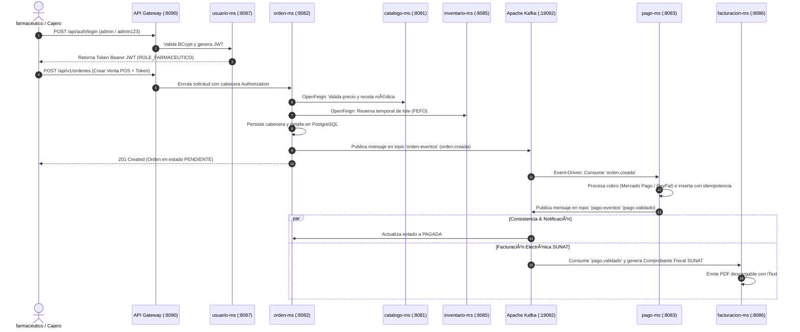

# 🎤 Guía Maestra de Exposición y Sustentación del Sistema MediZano POS

Esta guía prepara al equipo de **4 integrantes** para una sustentación técnica de alto impacto ante el jurado y profesor del curso **Desarrollo de Aplicaciones Distribuidas (UPeU 2026-2)**.

---

## 🚀 Tablero de Demostración en Vivo (1-Click)

Durante la exposición, mantén estas pestañas abiertas en el navegador del presentador:

| Servicio / Herramienta | URL Directa Local | Función en la Demostración |
| :--- | :---: | :--- |
| 📖 **Portal de Documentación MkDocs** | [http://localhost:8000/medizano/](http://localhost:8000/medizano/) | Mostrar arquitectura C4, brief técnico y Rúbrica oficial S12/S16. |
| 🛒 **Frontend Web POS (Angular 17)** | [http://localhost:4200/](http://localhost:4200/) | Demostración visual de la compra en farmacia y emisión de ticket. |
| 📑 **Swagger UI Centralizado (Gateway)** | [http://localhost:8090/swagger-ui.html](http://localhost:8090/swagger-ui.html) | Ejecución interactiva de endpoints y prueba de Bearer JWT. |
| 🔭 **Eureka Service Discovery** | [http://localhost:8761/](http://localhost:8761/) | Evidenciar las 8 instancias de microservicios registradas dinámicamente. |
| 📨 **Kafka UI (Kafbat)** | [http://localhost:18085/](http://localhost:18085/) | Inspección en tiempo real de los topics `orden-eventos` y `pago-eventos`. |
| 📊 **Grafana Dashboards** | [http://localhost:3000/](http://localhost:3000/) | Paneles de métricas JVM, throughput HTTP y correlación de logs con `traceId` *(admin/admin)*. |
| 📈 **Prometheus Server** | [http://localhost:9090/](http://localhost:9090/) | Consulta de métricas de Spring Boot Actuator (`/actuator/prometheus`). |

---

## ⏱️ Cronograma de Exposición (10 Minutos)

| Minuto | Integrante | Tema de Sustentación | Enfoque Técnico Evaluado |
| :---: | :--- | :--- | :--- |
| **00:00 - 02:00** | **Kenyi Calsin** | Introducción, Arquitectura C4 y Resiliencia | OpenFeign, Circuit Breaker Resilience4j, Database per Service. |
| **02:00 - 04:00** | **Igarlos Mamani** | Seguridad JWT/RBAC y Mensajería Kafka | Token JWT asimétrico, Gateway perimetral, Consumidor Idempotente. |
| **04:00 - 06:00** | **Aldo Calla** | Catálogo farmacéutico e Inventario Kardex FEFO | Regla de dispensación FEFO, Lotes con vencimiento, Compensación Saga. |
| **06:00 - 08:00** | **Juan Chambilla** | Facturación SUNAT, Comprobantes PDF y Proveedores | Desacople por eventos Kafka, Cálculo IGV 18%, iText PDF y DIGEMID. |
| **08:00 - 10:00** | **Todo el Equipo** | Observabilidad (Grafana/Loki/Prometheus) & Preguntas | Trazabilidad con TraceID, Métricas Actuator y defensa ante el jurado. |

---

## 🔐 Matriz de Usuarios y Credenciales para la Demostración en Vivo

Todas las cuentas se autentican con la contraseña **`admin123`** y permiten probar la protección de rutas por roles en Angular y Spring Security:

| Usuario | Contraseña | Rol / Perfil | Módulo para Probar en Demostración |
| :--- | :--- | :--- | :--- |
| **`admin`** | `admin123` | `ROLE_ADMIN` | Control total, bitácora de auditoría (`/user-activity`) y gestión de usuarios. |
| **`cajero`** | `admin123` | `ROLE_CASHIER` | Pantalla de venta POS (`/billing`), escaneo de medicamentos y cobro digital. |
| **`inventario`** | `admin123` | `ROLE_STOCK_MONITOR` | Monitoreo de existencias y lotes farmacéuticos FEFO (`/inventory`). |
| **`almacen`** | `admin123` | `ROLE_STOCK_KEEPER` | Catálogo de medicamentos y registro de ingresos por compras (`/medicines`). |
| **`soporte`** | `admin123` | `ROLE_CUSTOMER_SUPPORT` | Módulo de reclamos, devoluciones de medicamentos y notas de crédito (`/returns`). |
| **`analista`** | `admin123` | `ROLE_ANALYST` | Reportes de ventas, arqueo de caja y comprobantes fiscales (`/reports`). |
| **`gerente`** | `admin123` | `ROLE_MANAGER` | Historial consolidado de compras y superVisión general (`/purchase-history`). |


---

## 👥 Reparto Individual por Integrante (2 Microservicios c/u)

Cumpliendo con la directiva oficial del sílabo (**1 microservicio transaccional cabecera-detalle + 1 microservicio no transaccional catálogo/maestro por persona**):

---

### 1. Kenyi Calsin
* **Microservicio Transaccional:** `orden-ms` (`:8082`) — Tablas: `ordenes`, `orden_detalles`.
* **Microservicio No Transaccional:** `cliente-ms` (`:8084`) — Tabla: `clientes` (DNI/RUC, WhatsApp).
* **Defensa Técnica:**
  - Orquestación de ventas POS y comunicación Síncrona con `catalogo-ms` e `inventario-ms` mediante **OpenFeign**.
  - Resiliencia con **Resilience4j** (Circuit Breaker con fallback controlado ante caídas).
  - Emisión del evento asíncrono `orden.creada` hacia Apache Kafka.
* **Evidencia en Pantalla:**
  
* **Pregunta Clave:** *¿Qué evita que `orden-ms` se congele si `catalogo-ms` se cae?*
  - **Respuesta:** El Circuit Breaker de Resilience4j corta la llamada tras 2 segundos y ejecuta el método de fallback controlado sin agotar los hilos de Tomcat.

---

### 2. Aldo Calla
* **Microservicio Transaccional:** `inventario-ms` (`:8085`) — Tablas: `movimientos_inventario`, `lotes`.
* **Microservicio No Transaccional:** `catalogo-ms` (`:8081`) — Tablas: `medicamentos`, `categorias`.
* **Defensa Técnica:**
  - Control de existencias bajo la regla farmacéutica **FEFO (First Expired, First Out)** para priorizar medicamentos próximos a caducar.
  - gestión de movimientos Kardex (Entradas, Salidas, Ajustes y Devoluciones).
  - Compensación automática de stock si una orden es cancelada o el pago es rechazado.
* **Evidencia en Pantalla:**
  
* **Pregunta Clave:** *¿Por qué FEFO y no FIFO en farmacia?*
  - **Respuesta:** Porque en farmacología la caducidad es crítica para evitar pérdidas y riesgos para el paciente. Se expende el lote cuya fecha de expiración es más inmediata.

---

### 3. Igarlos Mamani
* **Microservicio Transaccional:** `pago-ms` (`:8083`) — Tabla: `pagos` (`uk_pagos_orden`).
* **Microservicio No Transaccional:** `usuario-ms` (`:8087`) — Tabla: `usuarios` (Roles, Hashes BCrypt).
* **Defensa Técnica:**
  - Seguridad perimetral y distribuida: Emisión y validación de tokens **JWT asimétricos** con roles RBAC (`ROLE_ADMIN`, `ROLE_FARMACEUTICO`, `ROLE_CLIENTE`).
  - Consumidor Kafka idempotente en `pago-ms` para procesar el cobro sin duplicidad ante reintentos de red.
  - Integración con pasarelas de pago externas (PayPal Sandbox y Mercado Pago).
* **Evidencia en Pantalla:**
  
* **Pregunta Clave:** *¿Cómo garantizas que no se cobre dos veces una orden si Kafka reintenta el mensaje?*
  - **Respuesta:** Mediante la restricción de base de datos `CONSTRAINT uk_pagos_orden UNIQUE (orden_id)`. Si llega un mensaje duplicado, se detecta antes de invocar la pasarela de pago.

---

### 4. Juan Chambilla
* **Microservicio Transaccional:** `facturacion-ms` (`:8086`) — Tablas: `facturas`, `factura_items`.
* **Microservicio No Transaccional:** `proveedor-ms` (`:8088`) — Tabla: `proveedores` (Registro Sanitario DIGEMID).
* **Defensa Técnica:**
  - Emisión fiscal electrónica de Boletas y Facturas cumpliendo la estructura SUNAT (cálculo de IGV 18%, montos gravados e inafectos).
  - Consumo del evento `pago.validado` para disparar la facturación de manera 100% desacoplada.
  - gestión de laboratorios farmacéuticos y contratos de suministro homologados por DIGEMID.
* **Evidencia en Pantalla:**
  
* **Pregunta Clave:** *¿Por qué facturación no es Síncrona en la caja registradora?*
  - **Respuesta:** Para desacoplar la experiencia del cajero. La orden se cobra y se entrega; la emisión del comprobante SUNAT y la generación del PDF se ejecutan aSíncronamente vía Kafka sin demorar la fila.

---

### 5. Suite de Observabilidad (Defensa Compartida)
Paneles unificados en Grafana con métricas Prometheus y logs de Loki indexados por `traceId`:


---

## 🔄 Flujo de Demostración End-to-End (Diagrama de Secuencia)



---

## ❓ Banco de Preguntas Típicas del Profesor y Respuestas Clave

### 1. ¿Por qué usamos *Database per Service* y cómo evitamos bloqueos de base de datos?
> **Respuesta:** Cada microservicio es dueño exclusivo de su esquema de PostgreSQL (tenemos 8 bases de datos independientes en el clúster). Ningún microservicio tiene credenciales ni permisos de red para hacer consultas cruzadas o JOINs directos sobre la base de otro servicio. La comunicación se realiza exclusivamente vía contratos HTTP (OpenFeign) para operaciones Síncronas o eventos Kafka para operaciones aSíncronas.

### 2. ¿Cómo manejan la consistencia distribuida si falla el pago?
> **Respuesta:** Implementamos el patrón **Saga Coreografiada**. Cuando `orden-ms` emite `orden.creada`, los medicamentos quedan reservados. Si `pago-ms` rechaza la transacción (fondos insuficientes o timeout), emite `pago.fallido`. `orden-ms` consume este evento compensatorio, marca la orden como `CANCELADA` y envía una petición compensatoria a `inventario-ms` para devolver el stock a su lote original.

### 3. ¿Cómo garantizan que un mensaje en Kafka no se procese dos veces (Idempotencia)?
> **Respuesta:** En `pago-ms`, la tabla `pagos` cuenta con una restricción de unicidad a nivel de base de datos: `CONSTRAINT uk_pagos_orden UNIQUE (orden_id)`. Además, el consumidor consulta primero si el `orden_id` ya fue procesado antes de invocar a la pasarela de pagos, descartando mensajes duplicados sin efectos colaterales.

### 4. ¿Qué sucede si `catalogo-ms` está caído cuando se intenta crear una orden?
> **Respuesta:** La llamada OpenFeign está envuelta con un **Circuit Breaker de Resilience4j**. Si `catalogo-ms` no responde dentro del umbral configurado (`timeoutDuration: 2s`), se ejecuta el método de fallback que responde con datos en caché o una respuesta controlada de degradación elegante, impidiendo el efecto dominó (cascading failure).

### 5. ¿Cómo se protegen los microservicios y quién valida el JWT?
> **Respuesta:** Aplicamos seguridad en capas (Defense in Depth). El **API Gateway** realiza la primera validación perimetral (formato, expiración y firma criptográfica). Luego, cada microservicio de negocio actúa como un **OAuth2 Resource Server** independiente que extrae los `authorities` del token y aplica control de acceso granular con `@PreAuthorize("hasRole('ROLE_FARMACEUTICO')")`.

---

## 🛠️ Comandos de Demostración en Terminal

```bash
# 1. Comprobar que los 18 contenedores están arriba y sanos
docker ps --format "table {{.Names}}\t{{.Status}}\t{{.Ports}}"

# 2. Verificar las 8 bases de datos PostgreSQL creadas
docker exec -it medizano-postgres psql -U postgres -d postgres -c "\l"

# 3. Inspeccionar los topics de Kafka directamente en consola
docker exec -it medizano-kafka /opt/kafka/bin/kafka-topics.sh --bootstrap-server localhost:9092 --list

# 4. Probar la salud de un microservicio a través del Gateway
curl -s http://localhost:8090/actuator/health

# 5. Ejecutar la auditoría funcional completa (10/10 OK)
node run_e2e_audit.js
```
