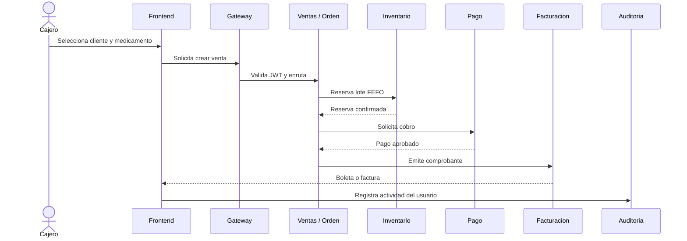

# Proyecto Sello: MediZano POS

## Propósito

MediZano POS integra las capacidades del curso de Desarrollo de Aplicaciones Distribuidas en una solución realista para una botica. El sistema permite vender medicamentos, controlar lotes y vencimientos, comprar a proveedores, emitir comprobantes, gestionar usuarios y observar el comportamiento de la plataforma.

## Producto de Unidad 1

El **Producto de Unidad 1** presenta la base distribuida del sistema:

- Ocho servicios de negocio separados por responsabilidad.
- Registro y descubrimiento con Eureka.
- API Gateway como entrada única.
- Persistencia independiente por microservicio.
- Frontend web para operar el sistema.
- Ejecución reproducible mediante Docker Compose.

## Producto de Unidad 2

El **Producto de Unidad 2** incorpora capacidades de robustez:

- Autenticación JWT y autorización por roles.
- Comunicación síncrona con APIs y Feign.
- Resilience4j para tolerancia a fallos.
- Eventos asíncronos con Kafka.
- Idempotencia y compensaciones para procesos distribuidos.
- Observabilidad con Prometheus, Loki y Grafana.
- Comprobantes y alertas enviados mediante SpaceMail SMTP autenticado.

## Equipo y responsabilidades

| Integrante | Microservicio transaccional | Microservicio no transaccional |
|---|---|---|
| Aldo Calla | Ventas y Facturación | Catálogo de Medicamentos |
| Kenyi Calsin | Inventario y Lotes | Reportes y Analítica |
| Igarlos Ruben | Compras y Abastecimiento | Notificaciones y Correos |
| Diego Chambilla | Usuarios y Autenticación | Auditoría y Actividad |

Un servicio transaccional cambia el estado del negocio. Un servicio no transaccional consulta, administra datos maestros o comunica información. Ambos se integran por APIs o eventos y no comparten tablas directamente.

## Flujo principal de una venta

## Criterios de diseño

- Cada servicio es dueño de su base de datos.
- Las relaciones entre dominios se resuelven con identificadores y APIs.
- Los eventos permiten desacoplar facturación, notificaciones y reportes.
- Los fallos se manejan con reintentos, circuit breaker o compensación.
- Los cierres de caja consideran ventas y reembolsos según su fecha de procesamiento.
- El historial de accesos se separa de la actividad operativa.

## Despliegue

El proyecto se despliega en AWS EC2 con Docker Compose. La instancia ejecuta el frontend, API Gateway, Eureka, los microservicios, PostgreSQL, Kafka y las herramientas de observabilidad. Los correos salen directamente por SpaceMail SMTP autenticado; no se instala un servidor web de correo dentro de la instancia. La documentación MkDocs se publica en el puerto 8000.

Consulta [Arquitectura y relaciones](arquitectura-relaciones.md) para ver los modelos 1:N, N:M, los límites de cada servicio y el flujo de despliegue.
