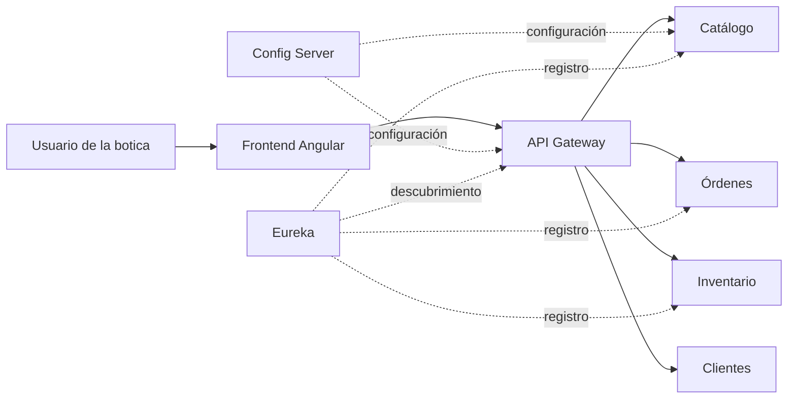
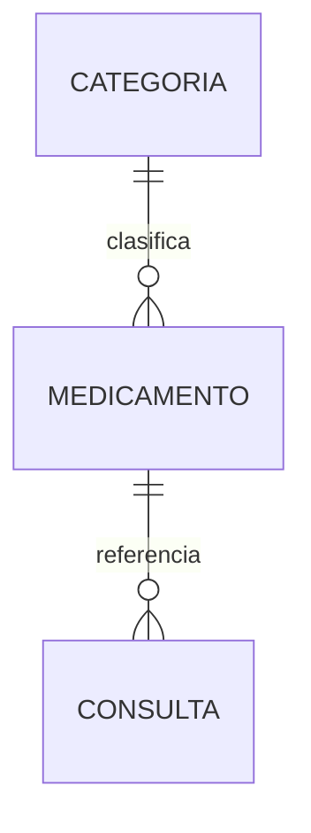
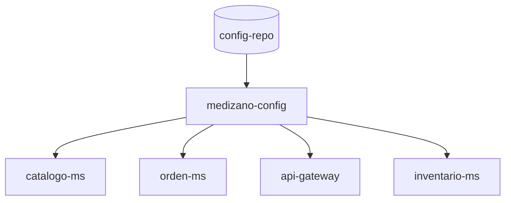
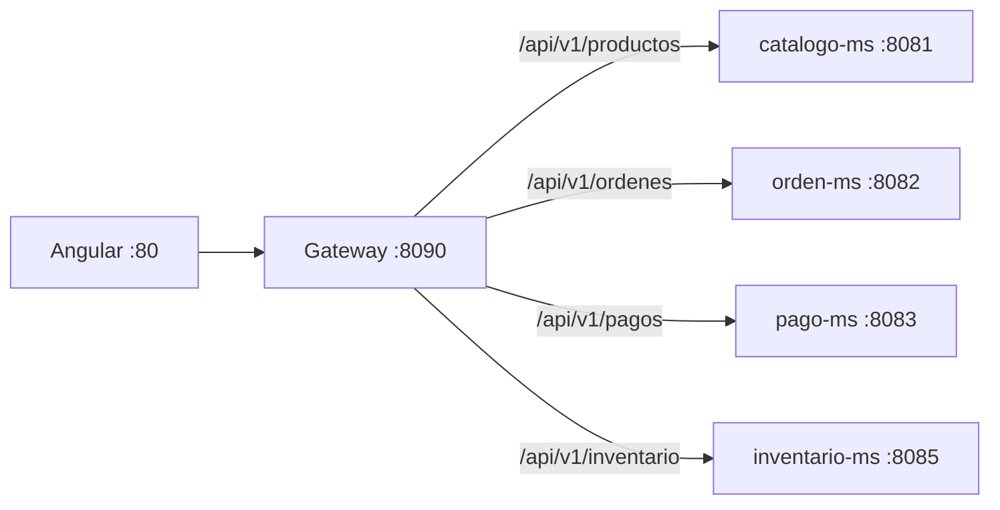
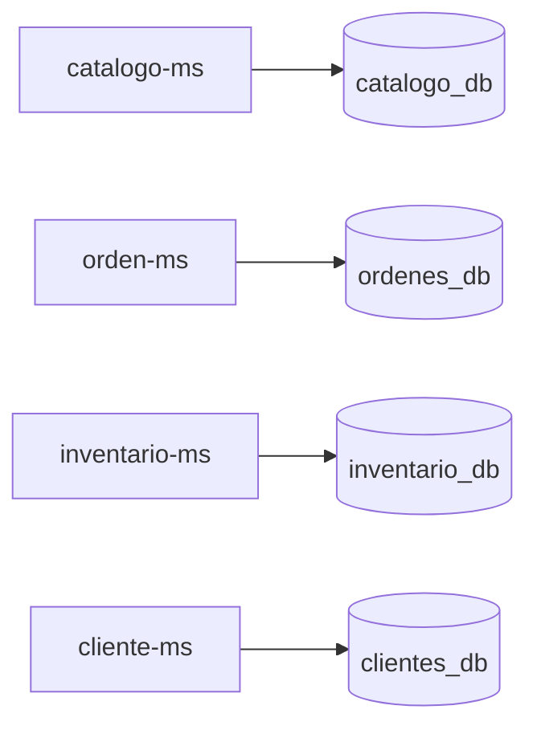
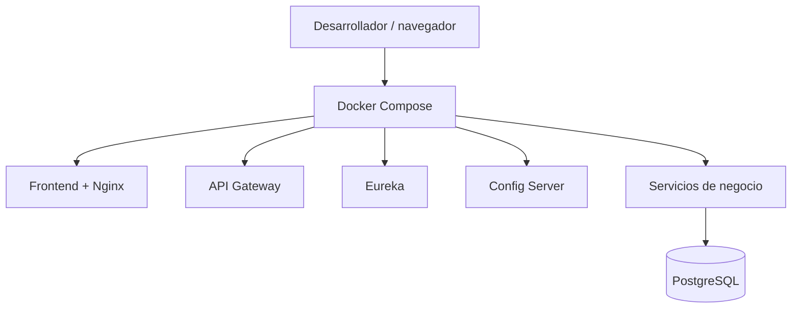

# Producto de Unidad 1 — Sistema distribuido base

## 1. ¿Qué entregamos?

En la Unidad 1 construimos la base funcional de **MediZano POS**, una plataforma para administrar una botica mediante servicios independientes. El producto no es solo una pantalla: incluye comunicación entre servicios, persistencia, descubrimiento, configuración centralizada, entrada única y una interfaz web operable.



### Resultado de la unidad

| Resultado | Evidencia | Qué demuestra |
|---|---|---|
| Servicio base funcional | [Frontend MediZano](../assets/images/medizano-frontend.png) | El usuario puede operar el sistema desde una interfaz web. |
| API centralizada | [Swagger Gateway](../assets/images/swagger-gateway.png) | Las APIs se publican desde un punto de entrada controlado. |
| Descubrimiento dinámico | [Instancias Eureka](../assets/images/eureka-instances.png) | Los servicios se registran sin depender de IPs fijas. |
| Configuración separada | `infra/medizano-config` y perfiles de aplicación | El código no depende de una sola configuración local. |
| Persistencia | PostgreSQL + migraciones Flyway | Los datos sobreviven al reinicio del contenedor. |
| Despliegue reproducible | `docker-compose.yml` | El entorno se levanta con servicios y dependencias coordinadas. |

## 2. Alcance de la Unidad 1

### Incluye

- Servicio de catálogo con medicamentos, categorías, precios y control de receta.
- Servicios de órdenes, clientes e inventario como base del flujo de venta.
- API Gateway como entrada única para el frontend.
- Eureka para registrar y descubrir servicios.
- Config Server para separar configuración de código.
- PostgreSQL como persistencia y Flyway para versionar el esquema.
- Angular como interfaz de operación.
- Docker Compose para levantar la solución completa.
- Swagger/OpenAPI y Actuator para comprobar salud y contratos.

### Todavía no es el objetivo de esta unidad

La Unidad 1 no pretende resolver toda la robustez de la plataforma. Seguridad avanzada, Kafka, Saga, observabilidad completa, SpaceMail, idempotencia y compensaciones se consolidan en la Unidad 2. La primera unidad entrega el **esqueleto ejecutable y conectable** sobre el que esas capacidades pueden crecer.

## 3. Componentes construidos

### 3.1 Catálogo: el servicio base del dominio

`catalogo-ms` administra los datos maestros que otros módulos necesitan consultar: medicamento, principio activo, presentación, categoría, precio y si requiere receta. Su función es responder de forma consistente; no descuenta existencias ni registra una venta.



### 3.2 Configuración centralizada

`medizano-config` concentra propiedades por ambiente. Así se puede cambiar la URL de Eureka, la base de datos o los puertos sin editar la lógica de cada microservicio.



**Beneficio:** el mismo artefacto puede ejecutarse en desarrollo, Docker o AWS usando variables y perfiles distintos.

### 3.3 Eureka: registro y descubrimiento

Eureka mantiene el registro lógico de los servicios. El Gateway utiliza nombres como `lb://catalogo-ms` en lugar de depender de una IP fija. Esto es importante en AWS porque la IP pública de una instancia puede cambiar.


### 3.4 API Gateway: una sola puerta de entrada

El frontend no necesita conocer el puerto interno de cada microservicio. Llama al Gateway y este enruta según la ruta configurada.




### 3.5 Persistencia y migraciones

Cada servicio tiene sus propias tablas y el esquema se crea mediante migraciones versionadas. El principio es **Database per Service**: ningún servicio hace `JOIN` directo contra la base de otro.



## 4. Cómo se demuestra el producto

### Prueba A — Arranque reproducible

```bash
docker compose up -d --build
docker compose ps
```

Se verifica que los contenedores de frontend, Gateway, Eureka, Config Server, PostgreSQL y servicios de negocio estén activos.

### Prueba B — Registro en Eureka

1. Abrir `http://localhost:8761`.
2. Confirmar que las instancias aparecen como `UP`.
3. Explicar que el Gateway resuelve servicios por nombre lógico.

### Prueba C — API desde Gateway

1. Abrir Swagger en `http://localhost:8090/swagger-ui.html`.
2. Ejecutar una consulta de medicamentos.
3. Confirmar que el Gateway enruta la petición a `catalogo-ms`.

### Prueba D — Interfaz web


La pantalla demuestra que el usuario no consume directamente la base de datos: utiliza la aplicación, el Gateway y los servicios registrados.

## 5. ¿Qué tiene de bueno esta primera unidad?

### Crece sin rehacer todo

El catálogo puede evolucionar sin modificar el Gateway ni el frontend completo. La misma estructura permite añadir pagos, facturación, compras y notificaciones como servicios separados.

### Cambia de ambiente sin cambiar el código

La configuración externa permite pasar de local a Docker o AWS modificando variables y perfiles, no clases Java.

### Evita depender de IPs fijas

Eureka y el Gateway resuelven servicios por nombre. Esto prepara el sistema para reinicios, múltiples instancias y despliegues en la nube.

### Hace visible el contrato

Swagger permite probar la API y Actuator permite consultar salud y métricas. La integración se puede demostrar, no solo afirmar.

### Mantiene límites claros

El catálogo no descuenta stock, el inventario no emite facturas y el Gateway no contiene reglas de negocio. Cada módulo tiene una responsabilidad defendible.

## 6. Arquitectura física del entorno



En AWS, estos componentes se ejecutan dentro de una instancia EC2 y se exponen mediante los puertos configurados. Para una dirección estable se recomienda Elastic IP o dominio; la arquitectura interna no debe depender de la IP pública.

## 7. Guion breve para presentar la Unidad 1

> “En esta unidad construimos la base distribuida de MediZano. El frontend entra por el API Gateway, el Gateway descubre los servicios mediante Eureka y cada servicio mantiene su propia persistencia. El catálogo funciona como servicio base, Config Server separa la configuración y Docker Compose hace reproducible el entorno. Con Swagger, Eureka y la pantalla del POS demostramos que la arquitectura está ejecutándose, no solo documentada.”

## 8. Evidencias del producto

| Evidencia | Archivo | Uso en la sustentación |
|---|---|---|
| Arquitectura general | [arquitectura-medizano.png](../assets/images/arquitectura-medizano.png) | Explicar componentes y límites. |
| Frontend | [medizano-frontend.png](../assets/images/medizano-frontend.png) | Mostrar operación del usuario. |
| Eureka | [eureka-instances.png](../assets/images/eureka-instances.png) | Probar descubrimiento. |
| Swagger | [swagger-gateway.png](../assets/images/swagger-gateway.png) | Probar el contrato del Gateway. |
| Prometheus | [prometheus-targets.png](../assets/images/prometheus-targets.png) | Mostrar salud de los targets. |

**Conclusión:** el Producto de Unidad 1 entrega una plataforma base funcional, observable y preparada para incorporar seguridad, eventos y resiliencia sin convertir todos los módulos en una sola aplicación monolítica.
