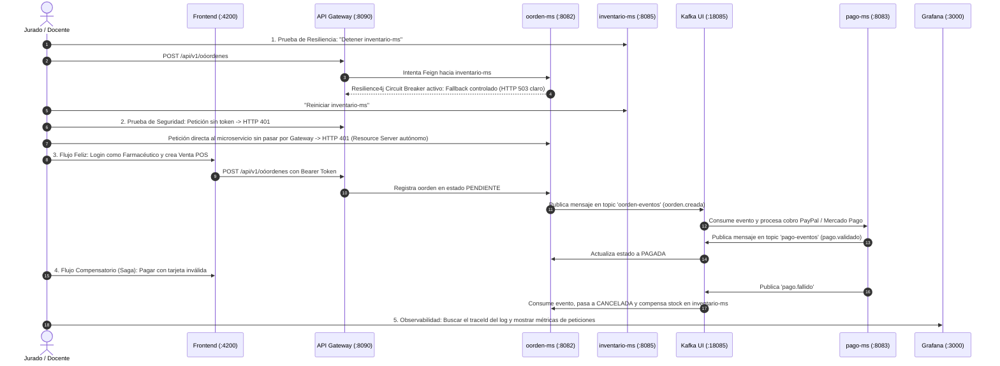

# Producto de Unidad 2: Sistema Distribuido Robusto

**MediZano POS — Evaluación y Sustentación Oficial S12 (CE023 Nivel 3)**

> [!IMPORTANT]
> ### 🚀 Tablero de Enlaces Directos en Vivo para la Sustentación
> * 📖 **Portal de Documentación MkDocs:** [http://localhost:8000/medizano/](http://localhost:8000/medizano/)
> * 📑 **Swagger UI Catálogo (`catalogo-ms`):** [http://localhost:8080/swagger-ui/index.html](http://localhost:8080/swagger-ui/index.html) *(o `:8081`)*
> * 📑 **Swagger UI Óóordenes (`oorden-ms`):** [http://localhost:8082/swagger-ui/index.html](http://localhost:8082/swagger-ui/index.html)
> * 📑 **Swagger UI Pagos (`pago-ms`):** [http://localhost:8086/swagger-ui/index.html](http://localhost:8086/swagger-ui/index.html) *(o `:8083`)*
> * 🔭 **Eureka Service Discovery:** [http://localhost:8761/](http://localhost:8761/)
> * 📨 **Kafka UI (Kafbat):** [http://localhost:18085/](http://localhost:18085/)
> * 📊 **Grafana Observabilidad:** [http://localhost:3000/](http://localhost:3000/) *(Usuario: `admin` / Password: `admin`)*
> * 📈 **Prometheus Server:** [http://localhost:9090/](http://localhost:9090/)

---

## 1. Propósito de la Evaluación

Esta sesión no enseña contenido nuevo: **cierra la Unidad II** del curso **Desarrollo de Aplicaciones Distribuidas**. El sílabo (sesión 12) define dos actividades para esta evaluación:

1. **Presentar el Producto de Unidad 2** construido con los temas de la Unidad II (sesiones 6 a 11).
2. **Presentar y sustentar el Sistema distribuido** seguro, resiliente, consistente, observable e integrado con cliente frontend.

> [!NOTE]
> Esta sesión no repite lo evaluado en S5: la Unidad I (servicio base, configuración, registro, Gateway y balanceo) ya quedó certificada; **S12 evalúa exclusivamente lo que se construyó encima en S6-S11**.

---

## 2. Producto Evaluado

Del sílabo, el producto de la Unidad II es:

> **Fortalece el sistema distribuido incorporando atributos de calidad, integración frontend y evidencias técnicas de operación real.**

El producto completo adaptado al dominio farmacéutico **MediZano POS** implementa: comunicación resiliente, seguridad distribuida en profundidad, mensajería asíncrona, consistencia distribuida (Saga e idempotencia), observabilidad e integración con cliente web.

### Tabla 1. Ensamblado de Capacidades de la Unidad II (MediZano POS)

| Sesión | Tema / Atributo | Capacidad que Agrega | Implementación Real en MediZano POS |
| :--- | :--- | :--- | :--- |
| **S6** | **Comunicación síncrona resiliente** | Timeout, reintentos y fallback ante caídas. | `oorden-ms` consulta y reserva stock en `catalogo-ms` e `inventario-ms` vía **Spring Cloud OpenFeign** con **Resilience4j** (timeout 2s, 3 reintentos y *fallback* controlado sin propagar caída en cascada). |
| **S7** | **Seguridad distribuida y control de acceso** | Autenticación, autorización y protección de rutas. | **JWT asimétrico / Keycloak** con roles RBAC (`ROLE_ADMIN`, `ROLE_FARMACEUTICO`, `ROLE_CLIENTE`). Cada microservicio valida el token de forma autónoma (Defensa en profundidad). |
| **S8** | **Mensajería asíncrona entre servicios** | Publicación y consumo de eventos desacoplados. | `oorden-ms` publica el evento `oorden.creada` al topic `oorden-eventos` en **Apache Kafka**. `pago-ms` lo consume asíncronamente sin acoplamiento temporal ni HTTP directo. |
| **S9** | **Consistencia distribuida en procesos** | Consistencia eventual, compensación e idempotencia. | Patrón **Saga Coreografiada**. Si el cobro falla, `pago-ms` emite `pago.fallido`, `oorden-ms` cancela el pedido y compensa restaurando el stock en `inventario-ms`. Consumidor protegido con `uk_pagos_oorden`. |
| **S10** | **Observabilidad y diagnóstico** | Logs correlacionados, métricas y dashboards. | Trazabilidad con `traceId` en cabeceras y MDC. Métricas expuestas vía **Actuator + Prometheus** y logs indexados en **Loki**, correlacionados en tableros interactivos de **Grafana** (:3000). |
| **S11** | **Integración con cliente frontend** | Consumo vía Gateway y protección por roles. | SPA **Angular 17** sobre Nginx (:4200) que consume la API **exclusivamente a través del Gateway** (:8090 / :18080) con Guíards de ruta (`canActivate`) según rol de usuario. |
| **S12** | **Integración y Sustentación Técnica** | Demostración end-to-end y defensa individual. | Sustentación técnica por los 4 integrantes (2 microservicios asignados por persona). |

---

## 3. Galería de Arquitectura y Evidencias Visuales

### Arquitectura Distribuida del Sistema MediZano POS

### Panel de Descubrimiento de Servicios (Eureka Service Discovery)

### Consola Kafka UI (Broker KRaft y Topics de Mensajería)

### Suite de Observabilidad Grafana (Métricas y Logs Correlacionados)

### Frontend Web POS (Angular 17)

### API Gateway Centralizado y Swagger UI

### Servidor de Métricas Prometheus

### Cliente Gráfico de Consultas y Endpoints

### Ejecución de Pruebas y Comprobación de Datos

---

## 4. Evidencia técnica del Producto de Unidad 2 (Temario S6 - S11)

### Tabla 1. Temario de Evaluación Teórica
| Sesión | Tema | Qué evalúa el jurado |
| :--- | :--- | :--- |
| **S6** | **Comunicación síncrona resiliente** | Timeout, reintentos, fallback y por qué un fallo en un servicio no debe propagarse en cascada al resto del sistema. |
| **S7** | **Seguridad distribuida y control de acceso** | Autenticación, autorización, protección de rutas, y por qué cada microservicio debe validar el token, no solo el Gateway. |
| **S8** | **Mensajería asíncrona entre servicios** | Publicación y consumo de eventos, desacople entre productor y consumidor, y diferencia con una llamada síncrona (REST/Feign). |
| **S9** | **Consistencia distribuida en procesos de negocio** | Consistencia eventual, compensación e idempotencia — por qué un proceso distribuido no puede usar una transacción ACID única entre servicios. |
| **S10** | **Observabilidad y diagnóstico de sistemas** | Logs, health checks, métricas y para qué sirve correlacionar evidencia entre servicios distintos ante un fallo. |
| **S11** | **Integración con cliente frontend** | Por qué el cliente consume la API solo a través del Gateway, y cómo se protegen las rutas según el rol del usuario. |

### ❓ Preguntas de Referencia y Respuestas Clave

1. **Si el servicio que llamas está caído, ¿qué evita que tu propio servicio también quede colgado esperando una respuesta que nunca llega?**
   * *Respuesta:* El **Circuit Breaker y Timeouts de Resilience4j** configurados en el cliente OpenFeign (`timeoutDuration: 2s`). Si el servicio destino no responde en el tiempo límite, se corta la llamada de inmediato y se dispara el método de *fallback* controlado, liberando los hilos del Tomcat para evitar saturación del pool.

2. **¿Por qué no basta con proteger las rutas en el Gateway, y qué pasa si un microservicio recibe una petición directa sin pasar por él?**
   * *Respuesta:* Por el principio de **Defensa en Profundidad (Zero Trust)**. Si un atacante o un servicio comprometido dentro de la red interna invoca directamente a un microservicio saltándose el Gateway, este seguiría vulnerable si no valida el token JWT. Por ello, cada microservicio actúa como un **OAuth2 Resource Server** que verifica autónomamente la firma criptográfica y los roles `@PreAuthorize`.

3. **¿Qué gana tu sistema al comunicar dos servicios por eventos en vez de una llamada REST directa, y qué pierde (qué garantía ya no tienes)?**
   * *Respuesta:* Se gana **desacoplamiento temporal y alta disponibilidad**: si el servicio destino está caído, el mensaje queda persistido en el broker Kafka y se procesará cuando se recupere. Se pierde la **inmediatez síncrona (consistencia fuerte ACID)**: ya no se tiene una confirmación instantánea en la misma transacción HTTP, debiendo operar bajo **consistencia eventual**.

4. **Si tu proceso de negocio falla a la mitad, ¿cómo evitas que quede en un estado inconsistente, y qué significa que sea idempotente?**
   * *Respuesta:* Se implementan **transacciones compensatorias** dentro de una **Saga Coreografiada** (por ejemplo, si falla el cobro, se dispara un evento `pago.fallido` que revierte la reserva de stock en `inventario-ms`). Que sea **idempotente** significa que procesar el mismo mensaje de Kafka dos o más veces produce exactamente el mismo resultado sin efectos secundarios (garantizado con la clave única `uk_pagos_oorden`).

5. **¿Qué evidencia concreta de tu panel de observabilidad te permitiría diagnosticar en qué servicio ocurrió una falla, sin revisar los logs uno por uno?**
   * *Respuesta:* El identificador de correlación **`traceId` (Micrometer Tracing / MDC)**. Al filtrar en Grafana Loki por el `traceId` de la petición fallida, aparecen en un único visor todos los registros emitidos en oorden cronológico por el Gateway, `oorden-ms`, `inventario-ms` y `pago-ms`, señalando la traza exacta de la excepción.

6. **¿Por qué tu cliente frontend nunca debería conocer la dirección de una instancia de microservicio directamente?**
   * *Respuesta:* Por **seguridad, encapsulamiento y elasticidad**. Si el cliente conoce IPs directas, queda expuesto el esquema interno de la red, se complican las políticas CORS, se anula la rotación dinámica de instancias de Eureka y se pierde el control perimetral centralizado de autenticación y rate limiting que provee el Gateway.

---

## 5. Sustentación del Sistema (Distribución y Entregables)

### Tabla 2. Distribución de Tiempo por Integrante (Total: 23 Minutos)

| Momento | Tiempo | Propósito | Responsable Principal |
| :--- | :---: | :--- | :--- |
| **Video pitch / Introducción ejecutiva** | **2 min** | Presentar en qué evolucionó el sistema desde la Unidad I hasta la robustez actual. | Kenyi Calsin |
| **Presentación técnica** | **8 min** | Explicar arquitectura, microservicios asignados (2 por persona) y decisiones técnicas. | Los 4 integrantes |
| **Demo técnica en vivo** | **8 min** | Provocar fallo controlado (resiliencia), evento Kafka, observabilidad en vivo y frontend. | Los 4 integrantes |
| **Preguntas individuales** | **5 min** | Responder preguntas conceptuales y de código del jurado basadas en la Tabla 1. | Individual (5 min c/u) |

### Tabla 3. Entregables Obligatorios

| Entregable | Evidencia Mínima | Criterio de Aceptación |
| :--- | :--- | :--- |
| **Producto de unidad** | `docs/proyecto-sello/u2-producto.md` adaptado a MediZano | Coherente con el sílabo y con código ejecutable. |
| **Evidencia de resiliencia y seguridad** | Fallo provocado en vivo con fallback; rutas protegidas validadas en >1 microservicio. | Trazabilidad verificable en vivo, no solo en diapositivas. |
| **Evidencia de mensajería y consistencia** | Evento publicado y consumido en Kafka; caso de reintento idempotente sin duplicar cobro. | Verificable en Kafka UI (`:18085`) y logs. |
| **Evidencia de observabilidad y frontend** | Panel de Grafana operativo correlacionando métricas y logs con `traceId`; Angular consumiendo vía Gateway. | Correlación real entre servicios, rutas con Guíards por rol. |
| **Repositorio y documentación** | Estructura completa en GitHub, documentación publicada en MkDocs. | Reproducible por terceros desde el repositorio. |
| **Sustentación individual** | Video pitch + defensa por integrante cubriendo los 7 subaspectos de evaluación. | Autoría y dominio técnico demostrados. |

---

## 6. Secuencia Sugerida de Presentación en Vivo (8 Minutos)

### Criterios Mínimos de Aceptación (Checklist)
- [x] Al menos un fallo de comunicación se provoca en vivo y el sistema responde con fallback controlado.
- [x] La seguridad se verifica en más de un microservicio, no solo en el Gateway.
- [x] Al menos un evento de negocio se publica y se consume de forma visible en Kafka UI.
- [x] Al menos un caso de consistencia (compensación o idempotencia) se prueba con fallo real.
- [x] El panel de Grafana correlaciona evidencia de al menos dos servicios distintos con `traceId`.
- [x] El cliente frontend consume la API completa a través del Gateway con rutas protegidas.
- [x] Cada integrante responde individualmente su pregunta de la Tabla 1.

---

## 7. Rúbrica Oficial de Evaluación (Unidad II)

$$\text{Nota Final} = \sum \left( \frac{\text{Peso} \times \text{Puntos}}{100} \right)$$

| Criterio | Peso | Competencia | Nivel A (20 pts) | Nivel B (15 pts) | Nivel C (10 pts) | Nivel D (5 pts) |
| :--- | :---: | :---: | :--- | :--- | :--- | :--- |
| **1. Comunicación síncrona resiliente** | 12% | CE023-N3 | Timeout, reintentos y *fallback* verificados en vivo provocando la caída forzada de una instancia. | Mecanismo presente, verificado parcialmente. | Definido en código, sin verificación ante fallo real. | No implementa respuesta controlada ante fallos. |
| **2. Seguridad distribuida y rutas** | 16% | CE023-N3 | Autenticación y autorización verificadas en todos los microservicios de forma independiente, no solo en Gateway. | Seguridad verificada en la mayoría de servicios. | Seguridad presente solo en el Gateway. | No implementa seguridad distribuida. |
| **3. Mensajería asíncrona desacoplada** | 16% | CE023-N3 | Evento `oorden.creada` publicado y consumido vía Kafka, con servicios probados de forma autónoma. | Mensajería funcional, con acoplamiento parcial. | Definida en código, sin verificación de desacople. | No implementa mensajería asíncrona. |
| **4. Consistencia, compensación e idempotencia** | 16% | CE023-N3 | Saga probada con fallo forzado (compensación de stock) y reprocesamiento de evento duplicado sin inconsistencia. | Consistencia verificada parcialmente (solo compensación o solo idempotencia). | Mencionada conceptualmente sin prueba real. | No evidencia consistencia distribuida. |
| **5. Observabilidad y diagnóstico** | 12% | CE023-N3 | Panel de Grafana operativo correlacionando métricas y logs con `traceId` entre microservicios ante una petición. | Panel operativo con correlación parcial. | Métricas o logs presentes sin panel ni correlación. | No presenta observabilidad verificable. |
| **6. Cliente frontend integrado** | 8% | CE023-N3 | Cliente Angular funcional consumiendo el sistema 100% vía Gateway, con sesión y rutas protegidas por rol. | Cliente funcional con llamadas directas fuera del Gateway o protección parcial. | Cliente parcialmente integrado. | No presenta frontend integrado. |
| **7. Sustentación técnica individual** | 20% | CG | Sustenta con solvencia, claridad y precisión técnica su aporte individual (sus 2 microservicios) y responde preguntas. | Sustenta con solvencia, con detalles menores en oorden o precisión. | Sustenta con dificultad y precisión insuficiente. | No sustenta adecuadamente ni demuestra aporte propio. |

---

## 8. Reparto de Responsabilidad Técnica por Integrante (4 Integrantes)

| N° | Integrante | Microservicio Transaccional | Microservicio No Transaccional | Puntos Fuertes en la Defensa Técnica |
| :---: | :--- | :--- | :--- | :--- |
| **1** | **Kenyi Calsin** | **`oorden-ms`** (`:8082`) • Tablas: `oóordenes`, `oorden_detalles` | **`cliente-ms`** (`:8084`) • Tabla: `clientes` (DNI/RUC) | Resiliencia Síncrona OpenFeign, Resilience4j Circuit Breaker, Orquestación de Pedidos POS. |
| **2** | **Aldo Calla** | **`inventario-ms`** (`:8085`) • Tablas: `movimientos_inventario`, `lotes` | **`catalogo-ms`** (`:8081` / `:8080`) • Tablas: `medicamentos`, `categorias` | Kardex Farmacéutico, Regla FEFO de Caducidad, Compensación de Existencias. |
| **3** | **Igarlos Mamani** | **`pago-ms`** (`:8083` / `:8086`) • Tabla: `pagos` (`uk_pagos_oorden`) | **`usuario-ms`** (`:8087`) • Tabla: `usuarios` (Roles, JWT) | Seguridad Distribuida RBAC, JWT Asimétrico, Consumidores Kafka Idempotentes y PayPal Sandbox. |
| **4** | **Juan Chambilla** | **`facturacion-ms`** (`:8086`) • Tablas: `facturas`, `factura_items` | **`proveedor-ms`** (`:8088`) • Tabla: `proveedores` (DIGEMID) | Comprobantes Fiscales SUNAT (Boletas/Facturas con IGV 18%), Desacople vía Eventos y Laboratorios DIGEMID. |
