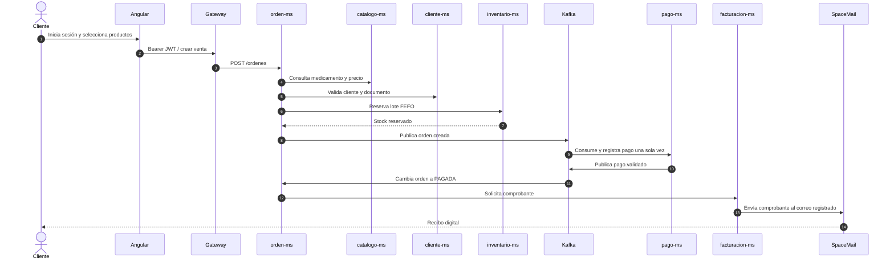
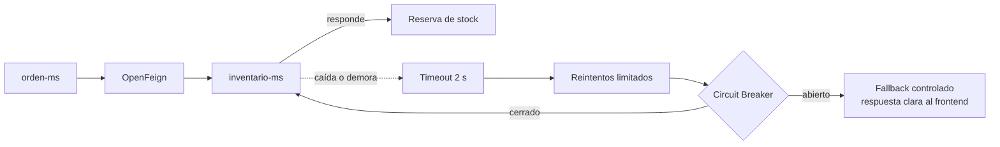
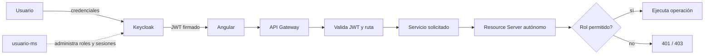
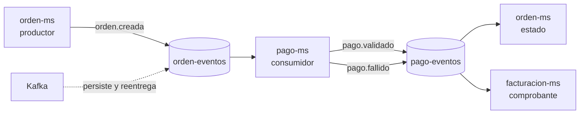
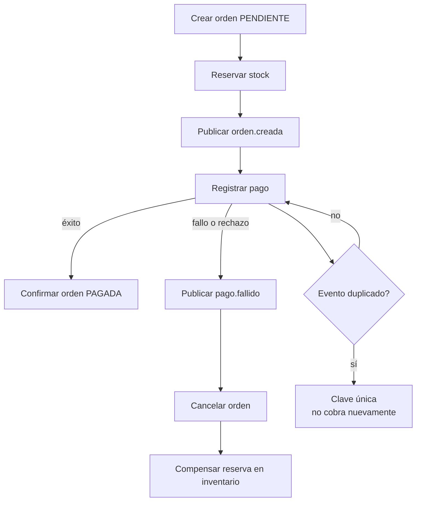
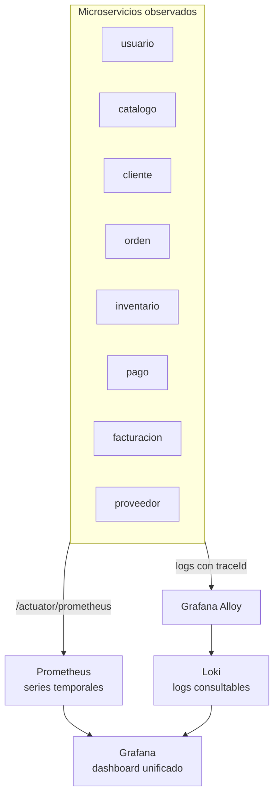
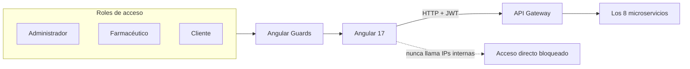
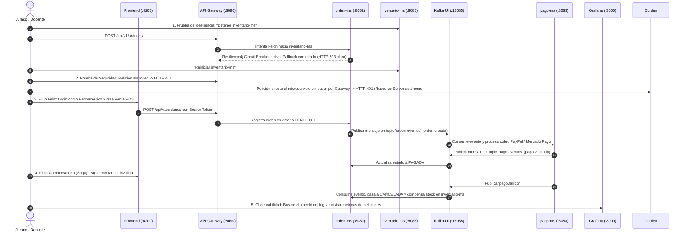

# Producto de Unidad 2 — Sistema Distribuido Robusto

**MediZano POS — Documentación técnica de las capacidades S6–S12**

> [!IMPORTANT]
> ### 🚀 Tablero de Enlaces Directos en Vivo para la Sustentación
> * 📖 **Portal de Documentación MkDocs:** [http://localhost:8000/medizano/](http://localhost:8000/medizano/)
> * 📑 **Swagger UI Catálogo (`catalogo-ms`):** [http://localhost:8080/swagger-ui/index.html](http://localhost:8080/swagger-ui/index.html) *(o `:8081`)*
> * 📑 **Swagger UI Órdenes (`orden-ms`):** [http://localhost:8082/swagger-ui/index.html](http://localhost:8082/swagger-ui/index.html)
> * 📑 **Swagger UI Pagos (`pago-ms`):** [http://localhost:8086/swagger-ui/index.html](http://localhost:8086/swagger-ui/index.html) *(o `:8083`)*
> * 🔭 **Eureka Service Discovery:** [http://localhost:8761/](http://localhost:8761/)
> * 📨 **Kafka UI (Kafbat):** [http://localhost:18085/](http://localhost:18085/)
> * 📊 **Grafana Observabilidad:** [http://localhost:3000/](http://localhost:3000/) *(Usuario: `admin` / Password: `admin`)*
> * 📈 **Prometheus Server:** [http://localhost:9090/](http://localhost:9090/)

---

## 1. Propósito del producto

La Unidad II fortalece la base construida en la Unidad I con capacidades que hacen que MediZano sea un sistema distribuido operable en producción: resiliencia, seguridad, eventos, consistencia, observabilidad e integración web.

1. Mostrar cómo funciona el producto construido con los temas S6–S11.
2. Explicar el recorrido de una operación desde Angular hasta los servicios, eventos, datos y observabilidad.

> [!NOTE]
> La Unidad II se apoya en el Gateway, Eureka, configuración y balanceo de la Unidad I, y agrega capacidades de calidad verificables en el flujo de negocio.

---

## 2. Mapa visual de la solución completa

El siguiente esquema muestra los **8 microservicios reales del repositorio**, sus límites de datos y las plataformas que los conectan. Cada servicio conserva su responsabilidad y su persistencia; las integraciones pasan por APIs o eventos, no por tablas compartidas.

```mermaid
flowchart TB
    U[Usuario] --> FE[Angular 17 / Nginx]
    FE --> GW[API Gateway]
    GW --> KC[Keycloak / JWT]
    GW --> DISC[Eureka + Config Server]

    subgraph MS[8 microservicios de MediZano]
      US[usuario-ms\nroles y sesiones]
      CA[catalogo-ms\nmedicamentos]
      CL[cliente-ms\nclientes y documentos]
      OR[orden-ms\nventas y órdenes]
      IN[inventario-ms\nstock, lotes y FEFO]
      PA[pago-ms\npagos e idempotencia]
      FA[facturacion-ms\ncomprobantes]
      PR[proveedor-ms\ncompras y recepción]
    end

    GW --> US & CA & CL & OR & IN & PA & FA & PR
    US & CA & CL & OR & IN & PA & FA & PR --> DB[(PostgreSQL\nbase por servicio)]
    OR -. orden.creada .-> K[(Kafka)]
    K -. pago.validado / pago.fallido .-> PA
    K -. eventos de negocio .-> FA
    OR -. reserva y compensación .-> IN
    FA --> SM[SpaceMail SMTP]

    subgraph OBS[Observabilidad]
      AC[Actuator] --> PM[Prometheus]
      AL[Alloy] --> LK[Loki]
      PM & LK --> GR[Grafana]
    end
    US & CA & CL & OR & IN & PA & FA & PR -. métricas y logs .-> OBS
```

### Cómo leer el mapa

1. El frontend solo conoce al Gateway; no expone IPs internas de los microservicios.
2. Las llamadas REST/Feign resuelven respuestas inmediatas, por ejemplo consultar stock.
3. Kafka transporta eventos que pueden procesarse después, como `orden.creada`.
4. Cada servicio administra sus propios datos y publica el resultado que otros necesitan.
5. Prometheus, Loki y Grafana observan los ocho servicios sin mezclar sus responsabilidades.

## 3. Flujo de una venta de extremo a extremo



Este recorrido relaciona los ocho servicios: `usuario-ms` protege la sesión y los roles; `catalogo-ms`, `cliente-ms`, `inventario-ms` y `orden-ms` participan en la venta; `pago-ms` confirma el cobro; `facturacion-ms` emite el comprobante; `proveedor-ms` mantiene el abastecimiento que repone el inventario.

---

## 4. Capacidades incorporadas

Del sílabo, el producto de la Unidad II es:

> **Fortalece el sistema distribuido incorporando atributos de calidad, integración frontend y evidencias técnicas de operación real.**

El producto completo adaptado al dominio farmacéutico **MediZano POS** implementa: comunicación resiliente, seguridad distribuida en profundidad, mensajería asíncrona, consistencia distribuida (Saga e idempotencia), observabilidad e integración con cliente web.

### Tabla 1. Ensamblado de capacidades de la Unidad II (MediZano POS)

| Sesión | Tema / Atributo | Capacidad que Agrega | Implementación Real en MediZano POS |
| :--- | :--- | :--- | :--- |
| **S6** | **Comunicación síncrona resiliente** | Timeout, reintentos y fallback ante caídas. | `orden-ms` consulta y reserva stock en `catalogo-ms` e `inventario-ms` vía **Spring Cloud OpenFeign** con **Resilience4j** (timeout 2s, 3 reintentos y *fallback* controlado sin propagar caída en cascada). |
| **S7** | **Seguridad distribuida y control de acceso** | Autenticación, autorización y protección de rutas. | **JWT asimétrico / Keycloak** con roles RBAC (`ROLE_ADMIN`, `ROLE_FARMACEUTICO`, `ROLE_CLIENTE`). Cada microservicio valida el token de forma autónoma (Defensa en profundidad). |
| **S8** | **Mensajería asíncrona entre servicios** | Publicación y consumo de eventos desacoplados. | `orden-ms` publica el evento `orden.creada` al topic `orden-eventos` en **Apache Kafka**. `pago-ms` lo consume asíncronamente sin acoplamiento temporal ni HTTP directo. |
| **S9** | **Consistencia distribuida en procesos** | Consistencia eventual, compensación e idempotencia. | Patrón **Saga Coreografiada**. Si el cobro falla, `pago-ms` emite `pago.fallido`, `orden-ms` cancela el pedido y compensa restaurando el stock en `inventario-ms`. Consumidor protegido con `uk_pagos_orden`. |
| **S10** | **Observabilidad y diagnóstico** | Logs correlacionados, métricas y dashboards. | Trazabilidad con `traceId` en cabeceras y MDC. Métricas expuestas vía **Actuator + Prometheus** y logs indexados en **Loki**, correlacionados en tableros interactivos de **Grafana** (:3000). |
| **S11** | **Integración con cliente frontend** | Consumo vía Gateway y protección por roles. | SPA **Angular 17** sobre Nginx (:4200) que consume la API **exclusivamente a través del Gateway** (:8090 / :18080) con Guíards de ruta (`canActivate`) según rol de usuario. |
| **S12** | **Integración y Sustentación Técnica** | Demostración end-to-end y defensa individual. | Sustentación técnica por los 4 integrantes (2 microservicios asignados por persona). |

---

## 5. Galería de arquitectura y evidencias visuales

### Arquitectura Distribuida del Sistema MediZano POS


### Panel de Descubrimiento de Servicios (Eureka Service Discovery)


### Consola Kafka UI (Broker KRaft y Topics de Mensajería)


### Suite de Observabilidad Grafana (Métricas y Logs Correlacionados)


### Frontend Web POS (Angular 17)


### API Gateway Centralizado y Swagger UI


### Servidor de Métricas Prometheus


### Cliente Gráfico de Consultas y Endpoints


### Ejecución de Pruebas y Comprobación de Datos


---

## 6. Cómo funciona cada capacidad técnica

### Tabla 2. Capacidades y explicación técnica
| Sesión | Tema | Cómo funciona en MediZano |
| :--- | :--- | :--- |
| **S6** | **Comunicación síncrona resiliente** | `orden-ms` llama a inventario mediante Feign; Resilience4j limita el tiempo, reintenta y devuelve un fallback controlado. |
| **S7** | **Seguridad distribuida y control de acceso** | Keycloak emite el JWT; Gateway y cada microservicio validan firma, expiración y roles antes de ejecutar una operación. |
| **S8** | **Mensajería asíncrona entre servicios** | `orden-ms` publica en Kafka; `pago-ms` y `facturacion-ms` consumen sin depender de una conexión HTTP abierta. |
| **S9** | **Consistencia distribuida en procesos de negocio** | Una Saga coordina estados y compensaciones; una clave única evita cobrar dos veces si Kafka reentrega el evento. |
| **S10** | **Observabilidad y diagnóstico de sistemas** | Actuator expone métricas, Alloy recoge logs, Loki los indexa y Grafana correlaciona todo mediante `traceId`. |
| **S11** | **Integración con cliente frontend** | Angular usa el Gateway como única entrada y sus guards ocultan rutas que no corresponden al rol del usuario. |

### S6 — Resiliencia ante una dependencia caída



El circuito evita que los hilos de `orden-ms` queden esperando indefinidamente. Cuando la dependencia se recupera, el circuito vuelve gradualmente a permitir llamadas.

### S7 — Seguridad distribuida y roles



El Gateway organiza la entrada, pero la protección no termina allí: `usuario-ms`, `catalogo-ms`, `cliente-ms`, `orden-ms`, `inventario-ms`, `pago-ms`, `facturacion-ms` y `proveedor-ms` pueden validar el token de manera independiente.

### S8 — Eventos Kafka y desacoplamiento



Kafka permite que el productor y los consumidores trabajen a ritmos distintos. Si un consumidor se reinicia, el evento puede continuar pendiente y procesarse después.

### S9 — Saga, compensación e idempotencia



La Saga no intenta compartir una transacción ACID entre bases distintas. Cada servicio confirma su paso y, si es necesario, ejecuta una acción compensatoria. La idempotencia hace seguro el reprocesamiento.

### S10 — Observabilidad de los ocho servicios



La imagen de observabilidad de la galería es una vista ilustrativa; este diagrama muestra el recorrido técnico real de las métricas y los logs. El `traceId` permite seguir una misma operación entre Gateway, orden, inventario, pago y facturación.

### S11 — Frontend, Gateway y rutas por rol



El frontend concentra la experiencia de usuario; el Gateway centraliza rutas y cada servicio vuelve a comprobar los permisos antes de modificar datos.

### ❓ Preguntas de Referencia y Respuestas Clave

1. **Si el servicio que llamas está caído, ¿qué evita que tu propio servicio también quede colgado esperando una respuesta que nunca llega?**
   * *Respuesta:* El **Circuit Breaker y Timeouts de Resilience4j** configurados en el cliente OpenFeign (`timeoutDuration: 2s`). Si el servicio destino no responde en el tiempo límite, se corta la llamada de inmediato y se dispara el método de *fallback* controlado, liberando los hilos del Tomcat para evitar saturación del pool.

2. **¿Por qué no basta con proteger las rutas en el Gateway, y qué pasa si un microservicio recibe una petición directa sin pasar por él?**
   * *Respuesta:* Por el principio de **Defensa en Profundidad (Zero Trust)**. Si un atacante o un servicio comprometido dentro de la red interna invoca directamente a un microservicio saltándose el Gateway, este seguiría vulnerable si no valida el token JWT. Por ello, cada microservicio actúa como un **OAuth2 Resource Server** que verifica autónomamente la firma criptográfica y los roles `@PreAuthorize`.

3. **¿Qué gana tu sistema al comunicar dos servicios por eventos en vez de una llamada REST directa, y qué pierde (qué garantía ya no tienes)?**
   * *Respuesta:* Se gana **desacoplamiento temporal y alta disponibilidad**: si el servicio destino está caído, el mensaje queda persistido en el broker Kafka y se procesará cuando se recupere. Se pierde la **inmediatez síncrona (consistencia fuerte ACID)**: ya no se tiene una confirmación instantánea en la misma transacción HTTP, debiendo operar bajo **consistencia eventual**.

4. **Si tu proceso de negocio falla a la mitad, ¿cómo evitas que quede en un estado inconsistente, y qué significa que sea idempotente?**
   * *Respuesta:* Se implementan **transacciones compensatorias** dentro de una **Saga Coreografiada** (por ejemplo, si falla el cobro, se dispara un evento `pago.fallido` que revierte la reserva de stock en `inventario-ms`). Que sea **idempotente** significa que procesar el mismo mensaje de Kafka dos o más veces produce exactamente el mismo resultado sin efectos secundarios (garantizado con la clave única `uk_pagos_orden`).

5. **¿Qué evidencia concreta de tu panel de observabilidad te permitiría diagnosticar en qué servicio ocurrió una falla, sin revisar los logs uno por uno?**
   * *Respuesta:* El identificador de correlación **`traceId` (Micrometer Tracing / MDC)**. Al filtrar en Grafana Loki por el `traceId` de la petición fallida, aparecen en un único visor todos los registros emitidos en orden cronológico por el Gateway, `orden-ms`, `inventario-ms` y `pago-ms`, señalando la traza exacta de la excepción.

6. **¿Por qué tu cliente frontend nunca debería conocer la dirección de una instancia de microservicio directamente?**
   * *Respuesta:* Por **seguridad, encapsulamiento y elasticidad**. Si el cliente conoce IPs directas, queda expuesto el esquema interno de la red, se complican las políticas CORS, se anula la rotación dinámica de instancias de Eureka y se pierde el control perimetral centralizado de autenticación y rate limiting que provee el Gateway.

---

## 7. Guion técnico y entregables

### Tabla 3. Orden sugerido de presentación (Total: 23 minutos)

| Momento | Tiempo | Propósito | Responsable Principal |
| :--- | :---: | :--- | :--- |
| **Video pitch / Introducción ejecutiva** | **2 min** | Presentar en qué evolucionó el sistema desde la Unidad I hasta la robustez actual. | Kenyi Calsin |
| **Presentación técnica** | **8 min** | Explicar arquitectura, microservicios asignados (2 por persona) y decisiones técnicas. | Los 4 integrantes |
| **Demo técnica en vivo** | **8 min** | Provocar fallo controlado (resiliencia), evento Kafka, observabilidad en vivo y frontend. | Los 4 integrantes |
| **Cierre técnico** | **5 min** | Explicar decisiones, responsabilidades y recorrido de una operación. | Los 4 integrantes |

### Tabla 4. Entregables del producto

| Entregable | Evidencia Mínima | Criterio de Aceptación |
| :--- | :--- | :--- |
| **Producto de unidad** | `docs/proyecto-sello/u2-producto.md` adaptado a MediZano | Coherente con el sílabo y con código ejecutable. |
| **Evidencia de resiliencia y seguridad** | Fallo provocado en vivo con fallback; rutas protegidas validadas en >1 microservicio. | Trazabilidad verificable en vivo, no solo en diapositivas. |
| **Evidencia de mensajería y consistencia** | Evento publicado y consumido en Kafka; caso de reintento idempotente sin duplicar cobro. | Verificable en Kafka UI (`:18085`) y logs. |
| **Evidencia de observabilidad y frontend** | Panel de Grafana operativo correlacionando métricas y logs con `traceId`; Angular consumiendo vía Gateway. | Correlación real entre servicios, rutas con Guíards por rol. |
| **Repositorio y documentación** | Estructura completa en GitHub, documentación publicada en MkDocs. | Reproducible por terceros desde el repositorio. |
| **Responsabilidad técnica** | Cada integrante explica un microservicio transaccional y uno no transaccional. | Autoría, límites y decisiones claramente identificados. |

---

## 8. Secuencia sugerida de demostración en vivo (8 minutos)




## 9. Presentación del producto

Esta página describe el producto técnico y sus evidencias. La documentación no incluye una fórmula de calificación ni una rúbrica personal.

## 10. Reparto de responsabilidad técnica por integrante

| N° | Integrante | Microservicio Transaccional | Microservicio No Transaccional | Puntos Fuertes en la Defensa Técnica |
| :---: | :--- | :--- | :--- | :--- |
| **1** | **Aldo Calla** | **`orden-ms`** (`:8082`)<br>• Órdenes y detalles de venta | **`catalogo-ms`** (`:8081`)<br>• Medicamentos y categorías | Flujo POS, consulta de productos y datos maestros. |
| **2** | **Kenyi Calsin** | **`inventario-ms`** (`:8085`)<br>• Lotes, kardex y movimientos | **`cliente-ms`** (`:8084`)<br>• Clientes y documentos | FEFO, control de stock y validación de datos del cliente. |
| **3** | **Igarlos Ruben** | **`proveedor-ms`** (`:8088`)<br>• Compras y recepción | **`facturacion-ms`** (`:8086`)<br>• Comprobantes y correo SpaceMail | Abastecimiento, IGV, comprobantes y notificaciones. |
| **4** | **Diego Chambilla** | **`pago-ms`** (`:8083`)<br>• Pagos e idempotencia | **`usuario-ms`** (`:8087`)<br>• Roles, JWT y sesiones | Seguridad, estados de pago y protección de rutas. |
