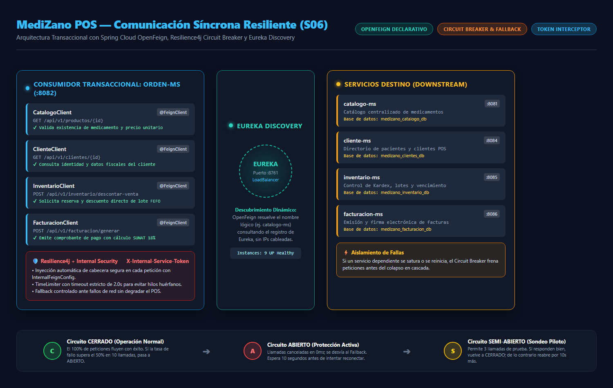
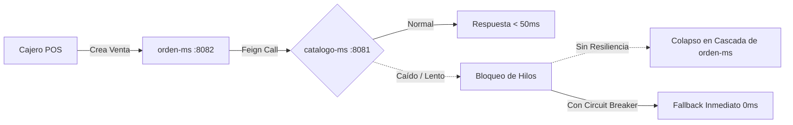
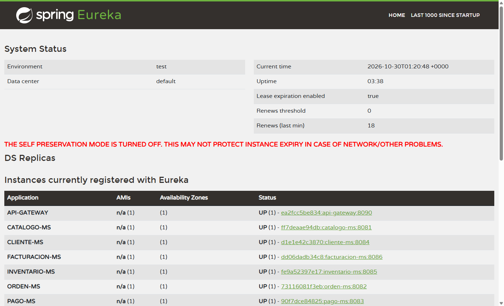
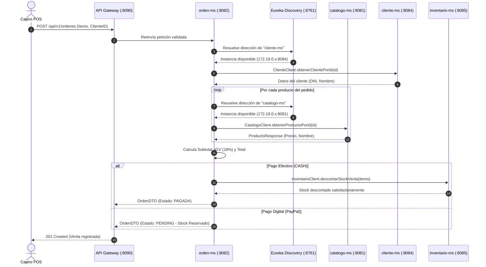
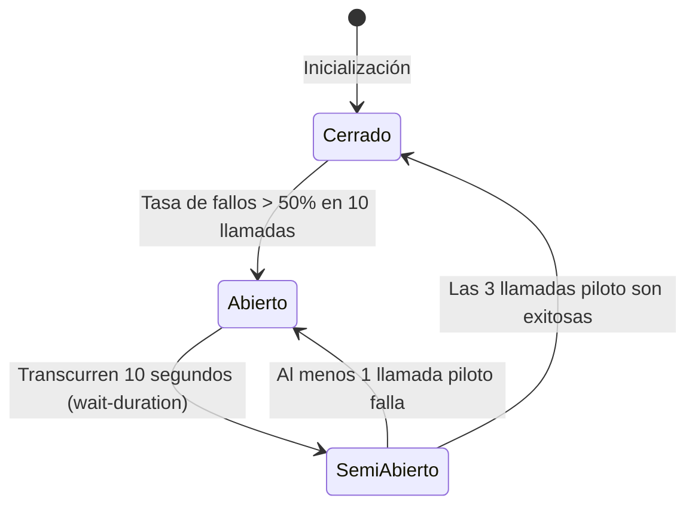
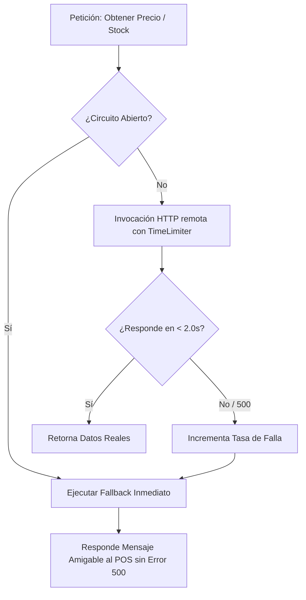
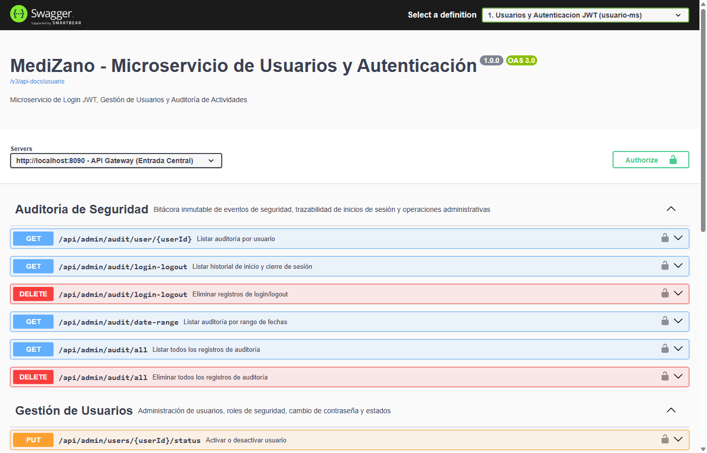

# S06 - Comunicación Síncrona Resiliente (OpenFeign + Resilience4j Circuit Breaker)

> **Sesión S06 · Desarrollo de Aplicaciones Distribuidas (UPeU)**  
> **Componente Principal:** `services/medizano-orden-ms` (Puerto `:8082`) $\leftrightarrow$ `catalogo-ms`, `cliente-ms`, `inventario-ms`, `facturacion-ms`  
> **Responsable:** Kenyi Calsin (Microservicio Transaccional de Órdenes)

---

## 1. Mapa Visual de la Arquitectura Síncrona

A continuación se presenta la topología completa de comunicación síncrona entre el microservicio transaccional `orden-ms` y sus servicios colaboradores, integrando descubrimiento dinámico vía **Eureka**, propagación de seguridad y protección con **Resilience4j**:



---

## 2. Propósito Arquitectónico y Desafío de la Sincronía

En una plataforma de punto de venta (POS) farmacéutico, la creación de una orden de venta requiere validar información crítica de forma síncrona antes de confirmar la compra:

1. **Precios e Identificación:** Consultar `catalogo-ms` para obtener el precio unitario vigente del producto.
2. **Directorio de Clientes:** Consultar `cliente-ms` para validar el documento de identidad o RUC/DNI.
3. **Reserva Inmediata de Lote:** Solicitar a `inventario-ms` el descuento de stock bajo el algoritmo FEFO (*First Expired, First Out*).
4. **Comprobante de Pago:** Enviar los detalles calculados a `facturacion-ms` para generar la factura con el 18% de IGV (SUNAT).

### El Peligro del Acoplamiento Temporal y Falla en Cascada

Las llamadas HTTP tradicionales síncronas generan **acoplamiento temporal**. Si `catalogo-ms` o `inventario-ms` se tornan lentos (latencia de 10 a 30 segundos) o caen por saturación:

* Cada petición entrante a `orden-ms` retiene un hilo del pool del servidor (Tomcat).
* En pocos segundos, los hilos de `orden-ms` se agotan por completo esperando respuestas remotas.
* `orden-ms` colapsa, bloqueando a los cajeros y botando el sistema POS entero (**falla en cascada**).



Para mitigar este riesgo de disponibilidad, MediZano implementa:

1. **Spring Cloud OpenFeign:** Cliente declarativo orientado a interfaces que elimina código repetitivo (`boilerplate`) y se integra de forma transparente con Eureka y Spring Cloud LoadBalancer.
2. **Resilience4j Circuit Breaker:** Monitorea la tasa de fallos en tiempo real mediante una ventana deslizante. Si los fallos superan el **50%**, el circuito se abre y desvía peticiones al método **Fallback** en milisegundos.
3. **Resilience4j TimeLimiter:** Interrumpe cualquier llamada remota que exceda los **2000 ms** (2 segundos).
4. **Token Interceptor de Seguridad:** Inyección automática de cabeceras de autorización mutua mediante `InternalFeignConfig`.

---

## 3. Clientes OpenFeign Implementados en `orden-ms`

El microservicio `orden-ms` define interfaces desacopladas para cada servicio con el que interactúa:

| Cliente Feign | Microservicio Destino | Endpoint Invocado | Propósito Transaccional |
| :--- | :--- | :--- | :--- |
| **`CatalogoClient`** | `catalogo-ms` (`:8081`) | `GET /api/v1/productos/{id}` | Valida código, nombre y precio unitario de venta |
| **`ClienteClient`** | `cliente-ms` (`:8084`) | `GET /api/v1/clientes/{id}` | Resuelve nombre, documento fiscal y correo del cliente |
| **`InventarioClient`** | `inventario-ms` (`:8085`) | `POST /api/v1/inventario/descontar-venta` | Ejecuta el descuento de existencias por lote |
| **`FacturacionClient`** | `facturacion-ms` (`:8086`) | `POST /api/v1/facturacion/generar` | Emite comprobante de pago con desglose tributario |

### Evidencia: Registro y Descubrimiento en Eureka

OpenFeign no requiere direcciones IP estáticas; resuelve las instancias dinámicamente mediante el nombre lógico registrado en Eureka:



---

## 4. Código Fuente de los Clientes y Filtro de Seguridad

### Definición de `CatalogoClient.java`
```java
package com.medizano.orden.client;

import lombok.Data;
import org.springframework.cloud.openfeign.FeignClient;
import org.springframework.web.bind.annotation.GetMapping;
import org.springframework.web.bind.annotation.PathVariable;

import java.math.BigDecimal;

@FeignClient(name = "catalogo-ms")
public interface CatalogoClient {

    @GetMapping("/api/v1/productos/{id}")
    ProductoResponse obtenerProductoPorId(@PathVariable("id") Long id);

    @Data
    class ProductoResponse {
        private Long id;
        private String nombre;
        private String codigo;
        private BigDecimal precioVenta;
        private Boolean estado;
    }
}
```

### Seguridad Inter-servicios (`InternalFeignConfig.java`)
Para evitar que clientes no autorizados invoquen endpoints internos de microservicios haciéndose pasar por `orden-ms`, se implementa un `RequestInterceptor` que inyecta automáticamente un token criptográfico en cada llamada saliente:

```java
package com.medizano.orden.config;

import feign.RequestInterceptor;
import org.springframework.beans.factory.annotation.Value;
import org.springframework.context.annotation.Bean;
import org.springframework.context.annotation.Configuration;

@Configuration
public class InternalFeignConfig {

    @Bean
    RequestInterceptor internalServiceTokenInterceptor(
            @Value("${security.internal-service-token}") String token) {
        return template -> template.header("X-Internal-Service-Token", token);
    }
}
```

---

## 5. Orquestación Síncrona en `OrdenService.java`

El siguiente diagrama de secuencia detalla el flujo síncrono que orquesta `OrdenService` al registrar una venta desde el Terminal POS:



---

## 6. Arquitectura del Circuit Breaker (Resilience4j)

El patrón **Circuit Breaker** actúa como un interruptor eléctrico de seguridad que detecta fallos repetitivos y corta el paso de corriente (solicitudes HTTP) para proteger tanto al cliente como al servicio remoto.



### Detalle de los Estados:

1. **Cerrado (Closed - Saludable):**
   * El tráfico fluye normalmente hacia el microservicio remoto.
   * Se registra el resultado en una ventana deslizante de tipo `COUNT_BASED` de 10 peticiones.
   * Si la tasa de llamadas fallidas supera el **50%**, el circuito conmuta automáticamente al estado **Abierto**.

2. **Abierto (Open - Cortocircuito Activado):**
   * Las llamadas entrantes son interceptadas y rechazadas **inmediatamente** en 0 milisegundos sin esperar timeout.
   * Se ejecuta la lógica de contingencia del método **Fallback**.
   * El circuito permanece bloqueado durante **10,000 ms** (10 segundos) para permitir que el servicio caído se recupere.

3. **Semi-Abierto (Half-Open - Fase de Evaluación):**
   * Tras expirar el tiempo de espera, el circuito permite pasar exactamente **3 llamadas piloto**.
   * Si las 3 llamadas responden correctamente, se asume que el servicio se estabilizó y el circuito vuelve a **Cerrado**.
   * Si alguna de las 3 llamadas falla o expira por timeout, el circuito vuelve inmediatamente al estado **Abierto** por otros 10 segundos.

---

## 7. Configuración de Parámetros en `application.yml`

```yaml
resilience4j:
  circuitbreaker:
    instances:
      catalogoClient:
        sliding-window-type: COUNT_BASED
        sliding-window-size: 10
        minimum-number-of-calls: 5
        failure-rate-threshold: 50.0
        wait-duration-in-open-state: 10000ms
        permitted-number-of-calls-in-half-open-state: 3
        automatic-transition-from-open-to-half-open-enabled: true
      inventarioClient:
        sliding-window-type: COUNT_BASED
        sliding-window-size: 10
        minimum-number-of-calls: 5
        failure-rate-threshold: 50.0
        wait-duration-in-open-state: 10000ms
        permitted-number-of-calls-in-half-open-state: 3
  timelimiter:
    instances:
      catalogoClient:
        timeout-duration: 2000ms
      inventarioClient:
        timeout-duration: 2500ms
```

### Justificación de Parámetros Clave:

| Parámetro | Valor Configurado | Justificación Técnica para POS |
| :--- | :---: | :--- |
| `sliding-window-size` | `10` | Evalúa las últimas 10 peticiones para tener una muestra estadística representativa sin retrasar la reacción. |
| `minimum-number-of-calls` | `5` | Evita falsos positivos; no calcula tasa de fallo hasta haber realizado al menos 5 llamadas. |
| `failure-rate-threshold` | `50.0%` | Si la mitad de las peticiones fallan o superan el timeout, el servicio se considera inestable. |
| `wait-duration-in-open-state`| `10000ms` | Da una ventana de 10 segundos al contenedor caído para reiniciar o desahogar su cola de hilos. |
| `timeout-duration` | `2000ms` | Ningún cajero de farmacia debe esperar más de 2 segundos por una consulta de precio unitario. |

---

## 8. Estrategia de Fallback y Degradación Elegante

Cuando se activa el Fallback, `orden-ms` intercepta la excepción `CallNotPermittedException` o `TimeoutException` y responde con una estrategia controlada:



```java
@Component
@Slf4j
public class CatalogoClientFallback implements CatalogoClient {

    @Override
    public ProductoResponse obtenerProductoPorId(Long id) {
        log.warn("[CircuitBreaker] Fallback activado para catalogo-ms en producto ID: {}", id);
        
        // Retorna un DTO de contingencia impidiendo una excepción HTTP 500 descontrolada
        ProductoResponse fallback = new ProductoResponse();
        fallback.setId(id);
        fallback.setNombre("Producto en Mantenimiento Temporal");
        fallback.setPrecioVenta(BigDecimal.ZERO);
        fallback.setEstado(false);
        return fallback;
    }
}
```

---

## 9. Evidencia de Endpoints en Swagger UI

Los contratos OpenAPI/Swagger de los microservicios sincronizados se encuentran unificados a través del Gateway perimetral:



---

## 10. Procedimiento de Verificación en Vivo

Para auditar el comportamiento del Circuit Breaker en la sustentación del proyecto, se ejecutan las siguientes pruebas:

### Paso 1: Operación Normal (Circuito Cerrado)
```bash
# Consultar orden con catalogo-ms saludable
curl -i -X GET http://localhost:8090/api/v1/ordenes \
  -H "Authorization: Bearer <TOKEN_VALIDO>"
```
* **Respuesta esperada:** `HTTP/1.1 200 OK` en menos de 45 ms.

### Paso 2: Simulación de Caída de Servicio Remoto
```bash
# Pausar el contenedor del catálogo para provocar timeout y fallos de conexión
docker pause medizano-catalogo-ms
```

### Paso 3: Disparo del Circuit Breaker
```bash
# Ejecutar 6 peticiones consecutivas de creación de orden
for i in {1..6}; do
  curl -s -o /dev/null -w "%{http_code} en %{time_total}s\n" \
    -X POST http://localhost:8090/api/v1/ordenes \
    -H "Content-Type: application/json" \
    -d '{"items":[{"productoId":1,"cantidad":2}],"metodoPago":"EFECTIVO"}'
done
```
* **Comportamiento observado:**
  * Las primeras llamadas esperan hasta 2.0s (TimeLimiter).
  * A partir de la 6ta llamada, el Circuit Breaker pasa a **ABIERTO**.
  * Las siguientes llamadas responden en **0.008s** desviadas al Fallback, garantizando que el microservicio de órdenes no quede congelado.

### Paso 4: Recuperación Automática (Transición a Semi-Abierto y Cerrado)
```bash
# Reanudar el contenedor de catálogo
docker unpause medizano-catalogo-ms

# Esperar 10 segundos (wait-duration-in-open-state)
sleep 10

# Realizar llamadas piloto
curl -i -X GET http://localhost:8090/api/v1/ordenes
```
* **Resultado:** El circuito detecta el éxito de las llamadas piloto y se restablece automáticamente a **CERRADO**.

---

## 11. Preguntas Clave para el Jurado (Sustentación Técnica)

* **¿Por qué eligieron OpenFeign sobre `WebClient` o `RestTemplate`?**  
  * *Respuesta:* OpenFeign permite una arquitectura puramente declarativa basada en interfaces y anotaciones de Spring MVC. Se integra de manera nativa con Eureka para balanceo de carga automático sin escribir lógica de sockets ni concatenación manual de URLs.

* **¿Cómo evita Resilience4j que una falla en catálogo tumbe el punto de venta?**  
  * *Respuesta:* Mediante el aislamiento de fallas (*Bulkhead* y *Circuit Breaker*). Si el catálogo cae, las peticiones se cortan de inmediato (0 ms) mediante el Fallback, impidiendo que los hilos de `orden-ms` se agoten esperando conexiones perdidas.

* **¿Por qué la ventana deslizante es de tipo `COUNT_BASED` y no `TIME_BASED`?**  
  * *Respuesta:* En un sistema POS, el volumen de transacciones se mide por operaciones de venta concretadas. Una ventana de conteo (10 llamadas) garantiza que el umbral del 50% reaccione ante una ráfaga de fallas independientemente de si ocurren en 5 segundos o en 2 minutos.

* **¿Cómo garantizan que un atacante externo no consuma directamente los endpoints internos vía Feign?**  
  * *Respuesta:* Con `InternalFeignConfig`, cada llamada síncrona adjunta la cabecera `X-Internal-Service-Token`. Los microservicios internos validan este token secreto; si una petición llega sin él (o desde fuera del Gateway), es rechazada con un código `403 Forbidden`.
