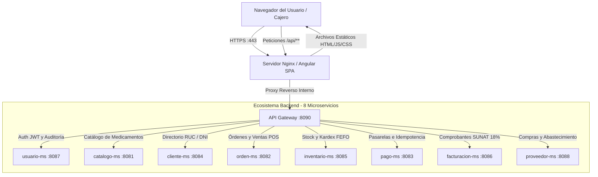
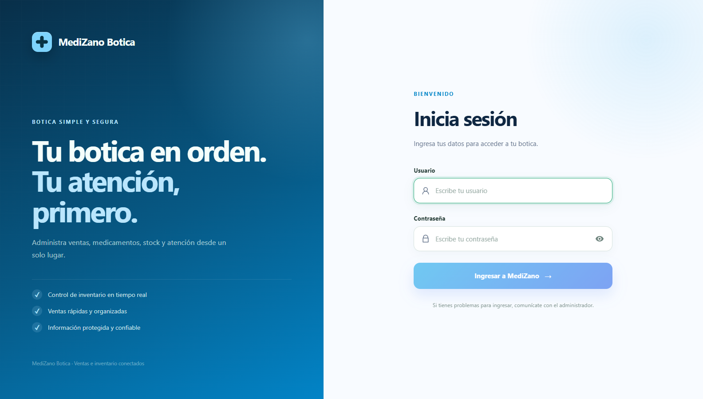
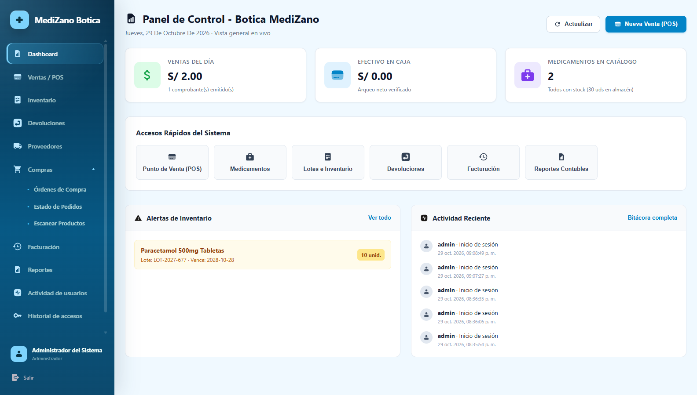
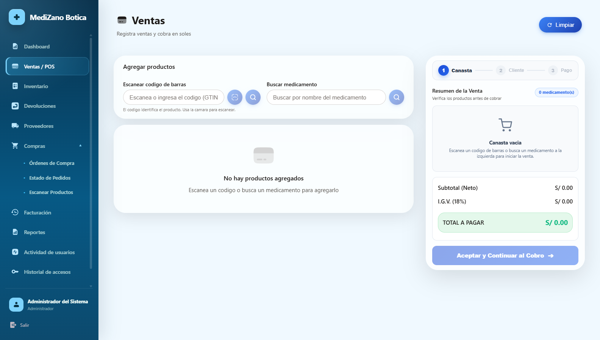
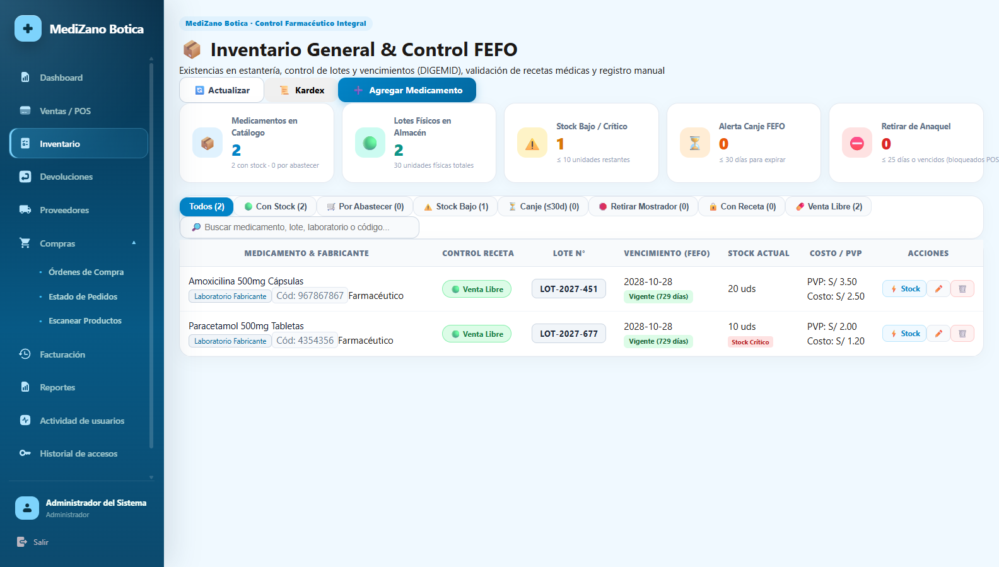
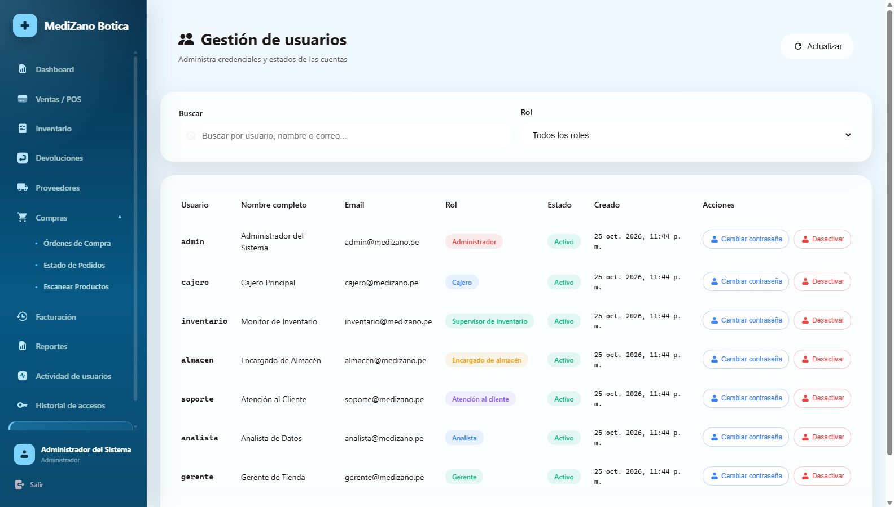
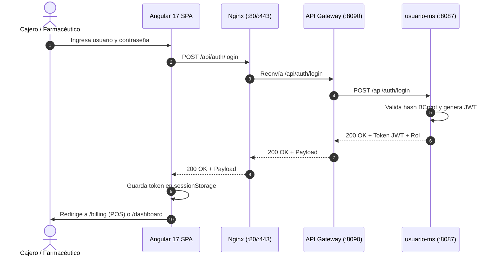

# S11 - Integración con Cliente Frontend (Angular 17 + Nginx + API Gateway)

> **Sesión S11 · Desarrollo de Aplicaciones Distribuidas (UPeU)**  
> **Componente Frontend:** `clients/medizano-frontend` (Angular 17 Standalone & Modules, Tailwind/SCSS)  
> **Alojamiento:** Nginx Alpine Container (Puertos `:80` HTTP / `:443` HTTPS / `:4200`)  
> **API Gateway Destino:** `infra/medizano-gateway` (Puerto `:8090`)

---

## 1. Propósito Arquitectónico

La capa de presentación de **MediZano POS** está construida como una aplicación de una sola página (*Single Page Application* - SPA) utilizando **Angular 17**. Su propósito es proporcionar a los cajeros, farmacéuticos y administradores una interfaz web moderna, ágil y reactiva para gestionar ventas, existencias de medicamentos y auditoría.

### Principios de Integración con el Sistema Distribuido:

1. **Desacoplamiento Total del Backend:** El cliente web no conoce las direcciones IP ni los puertos internos de ninguno de los 8 microservicios. Todas las interacciones se canalizan a través del **API Gateway** (`:8090`).
2. **Reverse Proxy en Nginx:** El servidor web Nginx intercepta las peticiones dirigidas a `/api/**` y las reenvía internamente al Gateway, eliminando por completo bloqueos por políticas de **CORS** (*Cross-Origin Resource Sharing*) en producción.
3. **Seguridad Basada en Tokens (JWT):** La autenticación es sin estado (*stateless*). El frontend adquiere un token firmado por `usuario-ms` y lo adjunta en cada solicitud HTTP mediante un interceptor centralizado.
4. **Control de Acceso Basado en Roles (RBAC):** Las vistas y módulos críticos (POS, Inventario, Gestión de Usuarios) están protegidos a nivel de cliente por **Angular Route Guards** (`AuthGuard` y `RoleGuard`).

---

## 2. Mapa de Integración Frontend ↔ Microservicios

El siguiente diagrama ilustra la arquitectura de integración donde el cliente web Angular y el servidor web Nginx interactúan con la totalidad de los **8 microservicios del ecosistema MediZano** exclusivamente a través del **API Gateway**:



---

## 3. Evidencias del Frontend en Ejecución Real (Google Chrome)

Las siguientes capturas de pantalla fueron tomadas directamente desde el navegador web **Google Chrome** en el entorno de producción en AWS:

### 3.1. Pantalla de Autenticación e Inicio de Sesión (`/auth/login`)
Formulario reactivo con validaciones en tiempo real para credenciales de acceso contra `usuario-ms`:



---

### 3.2. Panel de Control General (Dashboard) (`/dashboard`)
Resumen ejecutivo con métricas de ventas del día, dinero en caja, conteo de medicamentos en catálogo, alertas preventivas de inventario próximo a vencer y bitácora de actividad reciente:



---

### 3.3. Módulo de Venta y Punto de Venta POS (`/billing`)
Terminal de facturación rápida estructurada en tres etapas guiadas (**1. Canasta $\rightarrow$ 2. Cliente $\rightarrow$ 3. Pago**). Permite escaneo de códigos de barra GTIN, búsqueda dinámica de medicamentos, cálculo automático del IGV (18%) y despacho de venta síncrono:



---

### 3.4. Control de Inventario y Kardex FEFO (`/inventory`)
Monitoreo de existencias farmacéuticas bajo la normativa DIGEMID. Visualiza lotes físicos, alertas de semáforo (stock bajo o crítico), fecha de vencimiento y condición de venta (Libre o Bajo Receta Médica):



---

### 3.5. Administración de Usuarios y Permisos RBAC (`/user-management`)
Panel de gestión administrativa donde se auditan los estados de cuenta, correos corporativos y roles asignados (`Administrador`, `Cajero`, `Supervisor de inventario`, `Atención al cliente`, `Analista`, `Gerente`):



---

## 4. Implementación Técnica en Código Angular

### 4.1. Interceptor HTTP para Inyección de Token JWT (`token.interceptor.ts`)
Cada solicitud saliente hacia `/api/**` es interceptada para adjuntar el encabezado `Authorization: Bearer <TOKEN>`:

```typescript
@Injectable()
export class TokenInterceptor implements HttpInterceptor {
  constructor(private authService: AuthService) {}

  intercept(request: HttpRequest<unknown>, next: HttpHandler): Observable<HttpEvent<unknown>> {
    const token = this.authService.getToken();

    // Solo adjuntar en peticiones a endpoints de nuestra API
    if (token && request.url.includes('/api/')) {
      request = request.clone({
        setHeaders: {
          Authorization: `Bearer ${token}`
        }
      });
    }

    return next.handle(request);
  }
}
```

### 4.2. Protección de Rutas con Guards (`auth.guard.ts`)
Evita que usuarios no autenticados ingresen directamente a rutas protegidas mediante la URL del navegador:

```typescript
@Injectable({
  providedIn: 'root'
})
export class AuthGuard implements CanActivate {
  constructor(
    private authService: AuthService,
    private router: Router
  ) {}

  canActivate(): boolean {
    if (this.authService.isAuthenticated()) {
      return true;
    }

    // Redirigir a login si la sesión expiró o no existe token válido
    this.router.navigate(['/auth/login']);
    return false;
  }
}
```

---

## 5. Configuración del Servidor Web Nginx en Producción

El archivo `nginx.conf` empacado en la imagen Docker del frontend actúa como servidor de archivos estáticos y puente hacia el Gateway:

```nginx
server {
    listen 80;
    server_name localhost;

    # Archivos estáticos de Angular compilados (dist/)
    location / {
        root /usr/share/nginx/html;
        index index.html;
        try_files $uri $uri/ /index.html;
    }

    # Proxy reverso hacia Spring Cloud Gateway
    location /api/ {
        proxy_pass http://medizano-api-gateway:8090/api/;
        proxy_set_header Host $host;
        proxy_set_header X-Real-IP $remote_addr;
        proxy_set_header X-Forwarded-For $proxy_add_x_forwarded_for;
        proxy_set_header X-Forwarded-Proto $scheme;
    }
}
```

---

## 6. Flujo de Autenticación de Extremo a Extremo



---

## 7. Preguntas Clave para el Jurado (Sustentación Técnica)

* **¿Cómo resuelve la arquitectura los problemas de CORS entre Angular y los microservicios?**  
  * *Respuesta:* Mediante la configuración de Nginx como Reverse Proxy. El navegador envía todas las peticiones al mismo origen (`https://54.226.25.238/api/...`). Nginx reenvía internamente al Gateway en el puerto `:8090`, por lo que el navegador nunca detecta un cambio de origen o puerto cruzado.

* **¿Por qué se utilizó `useHash: true` en el enrutamiento de Angular?**  
  * *Respuesta:* `HashLocationStrategy` asegura que cualquier recarga de página (F5) en rutas profundas como `#/inventory` sea manejada por el motor de rutas del cliente sin requerir reescrituras complejas de servidor ni generar errores `HTTP 404 Not Found` en Nginx.

* **¿Dónde se almacena el JWT y qué ocurre si un usuario manipula su rol en el navegador?**  
  * *Respuesta:* El token se almacena en `sessionStorage`. Si un usuario altera los datos locales o el DOM para acceder a una pantalla no permitida, cualquier petición HTTP hacia el backend será rechazada con `401 Unauthorized` o `403 Forbidden` por los filtros de seguridad del API Gateway y Spring Security, ya que el token JWT está criptográficamente firmado con una clave secreta que el cliente no puede falsificar.
